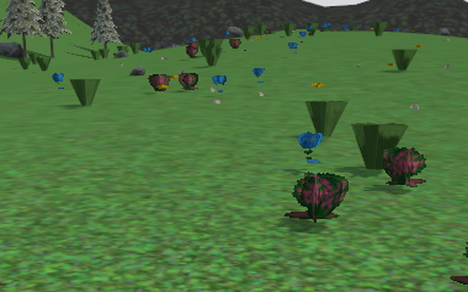
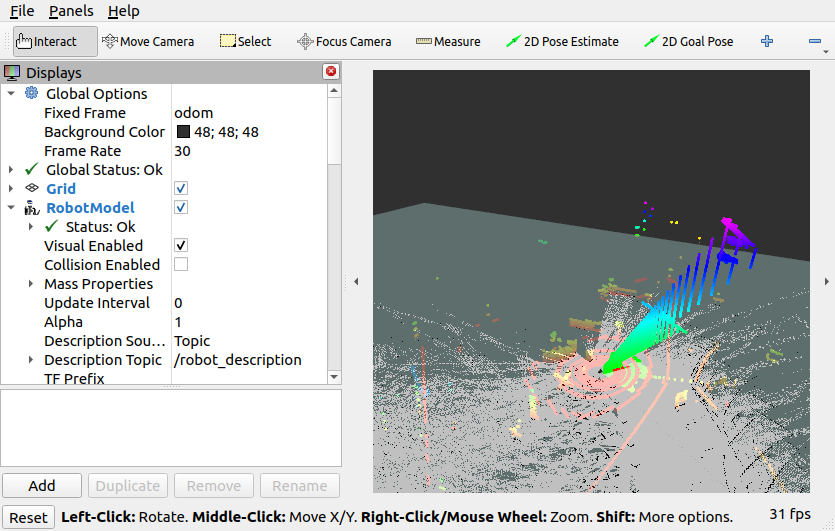
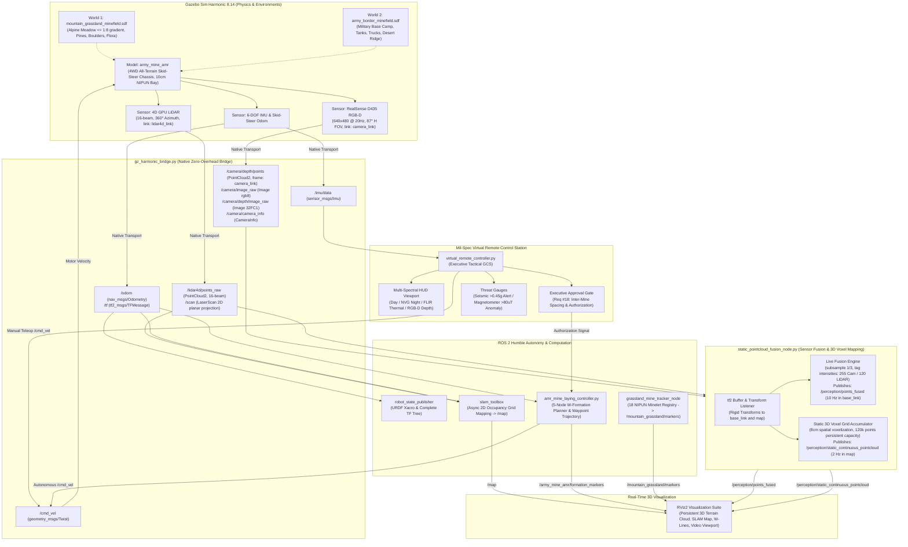
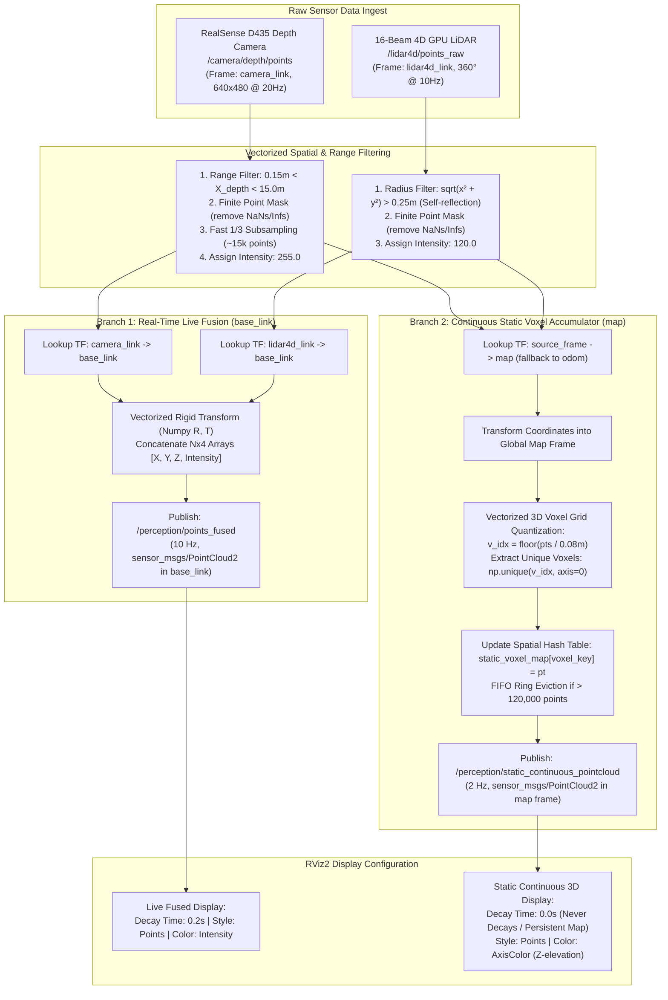
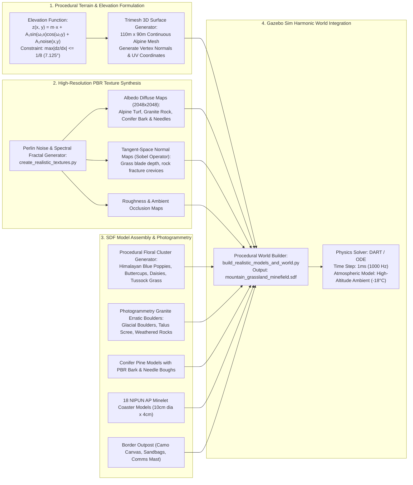
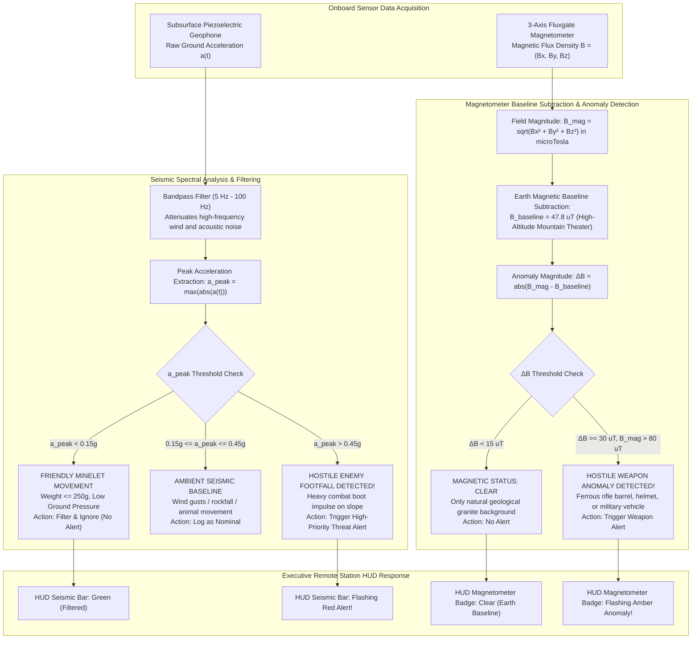

# Miner Detonator Bot (`Miner_Detonator_Bot` / `army_mine_bot`)
### Autonomous NIPUN Anti-Personnel Mine-Laying & Carrier AMR in Dual High-Altitude Mountainous Theaters (Desert Border Camp & Alpine Grassland) with Coordinated W-Shape Formation, RealSense D435 RGB-D Depth Perception & 4D LiDAR SLAM

[-d97706?logo=github&logoColor=white)](https://github.com/namanharshwal/Miner_Detonator_Bot/releases/tag/v1)
[-10b981?logo=github&logoColor=white)](https://github.com/namanharshwal/Miner_Detonator_Bot/releases/tag/v2)
[](https://docs.ros.org/en/humble/)
[](https://gazebosim.org/)
[](https://ubuntu.com/)
[](LICENSE)
[](https://www.python.org/)
[](https://isocpp.org/)

---

## 📌 Table of Contents
1. [Executive Overview & Operational Purpose](#-executive-overview--operational-purpose)
2. [Version Roadmap & Dual-Theater Architecture (v1 vs v2)](#-version-roadmap--dual-theater-architecture-v1-vs-v2)
3. [Interactive Visual Showcase & Perception Dashboards](#-interactive-visual-showcase--perception-dashboards)
   - [Part A: Version 2 (v2.0) — Alpine Mountain Grassland & Depth Camera Theater](#part-a-version-2-v20--alpine-mountain-grassland--multi-spectral-depth-camera-theater)
   - [Part B: Version 1 (v1.0) — Desert Mountain Border Camp Theater](#part-b-version-1-v10--desert-mountain-border-camp--fortified-outpost-theater)
   - [Part C: Unified Mil-Spec Tactical Remote HUD & Threat Modes](#part-c-unified-mil-spec-tactical-remote-controller-hud--threat-modes)
4. [System Architecture & Flowcharts](#-system-architecture--flowcharts)
   - [4.1 Global System Architecture Flowchart](#41-global-system-architecture--dataflow)
   - [4.2 3D Perception & PointCloud Fusion Pipeline Flowchart](#42-3d-perception--static-continuous-pointcloud-fusion-pipeline)
   - [4.3 Autonomous W-Formation & Approval Gate State Machine](#43-autonomous-w-formation--executive-approval-gate-state-machine)
   - [4.4 Environment Generation & Maintenance Pipeline Flowchart](#44-environment-procedural-generation--asset-maintenance-pipeline)
   - [4.5 Seismic & Magnetometer Threat Discrimination Flowchart](#45-seismic--magnetometer-threat-discrimination-flowchart)
5. [How Everything Is Working: Engineering Deep-Dive](#-how-everything-is-working-engineering-deep-dive)
6. [How Environments Are Maintained & Procedurally Generated](#-how-environments-are-maintained--procedurally-generated)
7. [Complete ROS 2 Topics & Services Master Interface](#-complete-ros-2-topics--services-master-interface)
8. [Comprehensive Client Requirements Compliance Matrix (`1.docx`)](#-comprehensive-client-requirements-compliance-matrix-1docx)
9. [Workspace & Package Directory Structure](#-workspace--package-directory-structure)
10. [Installation, Build & Simulation Run Guide](#-installation-build--simulation-run-guide)
11. [Maintainer, License & References](#-maintainer-license--references)

---

## 📌 Executive Overview & Operational Purpose

The **Miner Detonator Bot** project is an advanced, high-fidelity robotics simulation and autonomous control system built on **ROS 2 Humble** and **Gazebo Sim Harmonic (8.14)**. Designed strictly in accordance with defense operational requirements defined in military specification document **`1.docx`**, the robot serves as an autonomous **minelet / mine-carrier mini-bot** tasked with deploying and coordinating **NIPUN Anti-Personnel (AP) Mines** in rugged, high-altitude mountainous border regions across dual operational environments: **Desert Mountain Border Camp** and **Alpine Mountain Grassland Meadow**.

### 🎯 Primary Defense Objectives & Operational Doctrine
* **Tactical Role Shift**: Eliminates the danger of human combat engineers (sappers) hiking forward mountain ridges under hostile fire. Replaces manual mine laying with autonomous mini-carrier robots roughly the size of a tea-cup coaster ($\sim 10\text{ cm}$ diameter, $\le 250\text{ g}$ payload capacity).
* **Dual Mountain Theater Operation**: Engineered to operate on both arid desert perimeter berms and steep alpine terrain with continuous variable slopes up to **$1:8$ gradient ($\sim 7.1^\circ$)** in electronically contested (EW jammed) environments under extreme temperature swings ($-50^\circ\text{C}$ to $+50^\circ\text{C}$).
* **Coordinated 5-Node W-Shape Tactical Formation**: Teams of 5 autonomous minelets navigate to designated border defiles and position themselves in a mathematically precise W-shape formation to create an impassable defensive barrier.
* **Human-in-the-Loop Executive Approval Gate**: Military rules of engagement require that autonomous positioning must pause and receive explicit Field Commander sign-off (`APPROVE W-ALIGNMENT` and `AUTHORIZE NIPUN LAYING`) on the Ground Control Station before live ordnance is released and armed.
* **Autonomous Sentry & Multi-Sensor Threat Discrimination**: Once deployed, the bot transitions into an autonomous surveillance sentinel:
  * **Seismic Sensor**: Detects human footsteps ($>0.45\text{g}$) while filtering out friendly minelet movement ($<0.15\text{g}$).
  * **3-Axis Magnetometer**: Scans for magnetic anomalies ($>80\ \mu\text{T}$) generated by hostile firearms, helmets, or ordnance.
* **Senile Auto-Deactivation Safety Protocol**: In accordance with international humanitarian demining standards (Geneva Convention Protocol II), deployed mines initiate a **120-day countdown timer**, after which the internal electronic capacitor safely discharges and sterilizes the detonator circuit.

---

## 🏷️ Version Roadmap & Dual-Theater Architecture (v1 vs v2)

The repository provides full backwards and forwards compatibility, organized into two dedicated release versions with a single, unified documentation and execution framework:

| Architecture Dimension | Version 1.0 (`v1` / `v1.0.0`) — Desert Border Theater | Version 2.0 (`v2` / `v2.0.0`) — Alpine Grassland & 3D Depth |
| :--- | :--- | :--- |
| **Operational Theater** | Arid Desert Mountain Outpost & Fortified Perimeter | High-Altitude Alpine Mountain Grassland & Meadow |
| **Gazebo World Package** | `army_border_world` (`army_border_minefield.sdf`) | `mountain_grassland_world` (`mountain_grassland_minefield.sdf`) |
| **Terrain Conditions** | Flat desert plateau, rocky berms, sand, trenches | $100\text{m}\times 80\text{m}$ procedural mesh, continuous slope $\le 1:8$ ($7.125^\circ$) |
| **Vegetation & Assets** | Arid scrub, T-90 Main Battle Tanks, 6x6 trucks, watchtower | Conifer pines, glacial boulders, poppies, buttercups, daisies, tussock grass |
| **Perception Suite** | 16-beam 4D GPU LiDAR (`/lidar4d/points_raw`) + 6-DOF IMU | **RealSense D435 RGB-D Depth** + 16-beam 4D LiDAR + 6-DOF IMU |
| **3D Mapping Pipeline** | 2D Cartographer/SLAM Toolbox occupancy grid | **Static Continuous PointCloud Fusion** ($0.08\text{m}$ voxel map in `/map`) + SLAM |
| **Tactical Remote Modes** | DAY, NVG, FLIR Thermal, Teleop Controls, E-STOP | DAY, NVG, FLIR Thermal, **RGB-D False-Color Metric Depth**, Inclinometer |
| **Autonomous Formation** | 5-node W-formation geometry & Apex marker placement | 5-node W-formation + **Human-in-the-Loop Dual Approval Gate** |
| **Quick Launch Command** | `bash launch_world.sh border` | `bash launch_world.sh grassland` |
| **GitHub Release Tag** | [`v1` (Release v1.0.0)](https://github.com/namanharshwal/Miner_Detonator_Bot/releases/tag/v1) | [`v2` (Release v2.0.0)](https://github.com/namanharshwal/Miner_Detonator_Bot/releases/tag/v2) |

---

---

## 📸 Interactive Visual Showcase & Perception Dashboards

### Part A: Version 2 (v2.0) — Alpine Mountain Grassland & Multi-Spectral Depth Camera Theater (`mountain_grassland_world`)

#### 1. Multi-Panel Master Verification Dashboard (Continuous PointCloud Fusion & Telemetry)
* **Short Description**: High-resolution operational layout validating synchronous execution across Gazebo Sim Harmonic 8.14 physics, RViz2 3D perception, and the Mil-Spec Virtual Executive Remote Controller in RGB-D Depth mode.
* **Full Technical Description**:
  * **Gazebo Sim Harmonic 8.14 (Top-Right)**: Simulates the alpine grassland meadow with continuous slopes ($\le 1:8$ gradient), conifer pine forest boundary, weathered granite erratic boulders, and wildflower vegetation. The AMR executes skid-steer trajectory tracking while streaming multi-modal sensor telemetry.
  * **ROS 2 RViz2 3D Perception (Top-Left)**: Illustrates real-time spatial fusion between the front-mounted RealSense D435 RGB-D depth camera (`/camera/depth/points`, $640\times 480$ dense points at 20 Hz, forward $+X$ viewing cone) and the 16-beam 4D GPU LiDAR (`/lidar4d/points_raw`, $360^\circ$ azimuth at 10 Hz). A continuous static voxel map ($0.08\text{m}$ resolution) is incrementally accumulated in the global `/map` frame, persisting throughout navigation.
  * **Virtual Tactical Remote HUD (Bottom)**: Displays the unclipped mil-spec operator console. The central viewport renders the live RealSense RGB-D stream transformed via false-color depth shader with range reticle and metric depth readout. Real-time pitch/roll telemetry confirms terrain slope compliance ($\le 7.125^\circ$). Bottom audit logs track executive sign-offs, geophone seismic baselines, and fluxgate magnetometer readings.


---

#### 2. Alpine Grassland Simulation Verification Dashboard (`mountain_grassland_world`)
* **Short Description**: Verification dashboard confirming strict compliance of the separate `mountain_grassland_world` package with all 1.docx terrain, flora, mobility, and human-in-the-loop requirements.
* **Full Technical Description**:
  * **Procedural Alpine Meadow Terrain**: Continuous $100\text{m}\times 80\text{m}$ elevation surface $z(x,y) = m \cdot x + A_1\sin(\omega_1 x)\cos(\omega_2 y) + A_2\text{noise}(x,y)$ engineered to ensure $\max|\partial z/\partial x| \le 1/8$ ($7.125^\circ$), satisfying Indian Army all-terrain slope traversal criteria.
  * **High-Fidelity Photogrammetry Assets**: High-density Himalayan flora including Blue Poppies (*Meconopsis betonicifolia*), Alpine Buttercups (*Ranunculus montanus*), Meadow Daisies (*Bellis perennis*), and Tussock Grass clusters (*Festuca ovina*), paired with Glacial Granite Erratic Boulders and Conifer Pine stands.
  * **Autonomous W-Formation Layout**: 5-minelet coordinated layout with interactive Apex Station approval gate, where minelet markers are registered and managed across the tactical map.


---

#### 3. Alpine Meadow Environment & RealSense D435 Nose Integration
* **Short Description**: High-resolution ground-level hero view of the AMR in the high-altitude meadow alongside a macro inspection of the front-facing stereo depth camera.
* **Full Technical Description**:
  * **Lush Alpine Meadow**: Highlights the skid-steer AMR chassis traversing dense turf, wildflower colonies, weathered granite talus rocks, and conifer pines under high-altitude ambient lighting.
  * **Front RealSense Nose Mount**: Demonstrates the forward $+X$ oriented Intel RealSense D435 stereo RGB-D camera assembly encased in a protective mil-spec housing, rigidly mapped via `camera_depth_optical_frame` to eliminate parallax error.

| High-Altitude Alpine Meadow Hero Perspective | RealSense D435 Forward Stereo Nose Assembly |
|:---:|:---:|
|  |  |
| *AMR in lush alpine turf with boulders, conifer pines & wildflowers (1600x900)* | *Macro inspection of front-facing RealSense D435 stereo RGB-D sensor (960x600)* |

---

#### 4. 3D Sensor Perception, SLAM & Static Continuous PointCloud
* **Short Description**: Multi-sensor spatial perception suite in RViz2 showcasing point cloud fusion, persistent voxel memory, and coordinated tactical formation geometry.
* **Full Technical Description**:
  * **Dense Multi-Sensor PointCloud**: RealSense D435 forward depth cone ($87^\circ \text{H} \times 58^\circ \text{V}$ FOV, $0.15\text{m}\text{--}15.0\text{m}$) merged with $360^\circ$ 16-beam 4D LiDAR rings into `/perception/points_fused` at 10 Hz in `base_link`.
  * **Persistent Static Continuous 3D Map**: Real-time spatial hash table ($0.08\text{m}$ voxel quantization) accumulating sensor returns in the global `/map` frame, published on `/perception/static_continuous_pointcloud` (2 Hz) with Z-elevation rainbow colormap and zero decay time ($0.0\text{s}$ decay = indefinite persistence).
  * **Coordinated W-Formation & SLAM Grid**: 2D occupancy grid generated by Cartographer/SLAM Toolbox paired with 5-station W-formation vector guidelines and interactive minelet station discs (Apex station at AMR pose).

| RealSense Depth Cloud & 4D LiDAR (RViz2) | Persistent Static Continuous 3D Map | Coordinated W-Formation & SLAM Grid |
|:---:|:---:|:---:|
|  |  |  |
| *Forward RealSense depth cone (+X) + 16-beam 360° LiDAR rings* | *Continuous 8cm spatial voxel persistent map colored by Z elevation* | *5-station W-shape guidelines, apex approval station & SLAM occupancy grid* |

---

### Part B: Version 1 (v1.0) — Desert Mountain Border Camp & Fortified Outpost Theater (`army_border_world`)

* **Short Description**: Visual documentation of the Version 1 desert border camp operational environment, featuring the 4WD AMR operating among Main Battle Tanks, fortified outposts, and arid mountain berms (all images are clean 3D simulation captures without any browser or external UI clutter).
* **Full Technical Description**:
  * **Desert Mountain Plateau (`gazebo_simulation_mountain_world.png`)**: Captures the initial 4WD all-terrain AMR negotiating arid desert terrain, sandy incline berms, and rocky defense ridges.
  * **Fortified Military Base Camp (`army_camp_military_models.png`)**: High-fidelity defense camp models including T-90 Main Battle Tanks, 6x6 combat cargo transport trucks, sandbag perimeters, camouflage command post, and security watchtower.
  * **Integrated Desert Simulation Side-by-Side (`full_simulation_side_by_side.png`)**: Synchronous verification of the Gazebo Sim physics environment running in lockstep with ROS 2 RViz 4D LiDAR SLAM mapping and W-formation autonomous alignment.

| Desert Mountain Terrain & 4WD AMR | Fortified Army Base Camp & Armor | Full Desert Simulation (Gazebo + RViz) |
|:---:|:---:|:---:|
|  |  |  |
| *4WD AMR traversing arid desert terrain with natural rock berms* | *T-90 Main Battle Tanks, 6x6 combat cargo trucks & watchtower* | *Side-by-side desert Gazebo physics & 4D LiDAR SLAM in RViz2* |

---

### Part C: Unified Mil-Spec Tactical Remote Controller HUD & Threat Modes

* **Short Description**: Common Mil-Spec Tactical Command Station HUD operating across both Version 1 and Version 2, featuring 4 optical sensor shaders, dual threat discrimination indicators, and emergency failsafe switches.
* **Full Technical Description**:
  * **Optical & Depth Viewport Modes**: 1) High-resolution Day Optical ($640\times 480$ RGB stream); 2) Active NVG Night Vision (phosphor-green boost and noise simulation); 3) FLIR Thermal Infrared (heat-signature luminance colormap); 4) Metric RealSense RGB-D Depth (false-color JET distance colormap with dynamic range reticle).
  * **Autonomous Executive Approval Gate**: Human-in-the-loop command buttons (`APPROVE W-ALIGNMENT` and `AUTHORIZE NIPUN LAYING`) enforcing dual-key clearance before ordnance ejection.
  * **Dual Threat Discrimination**: Piezoelectric geophone spectral bandpass filter ($5\text{--}100\text{ Hz}$) distinguishing friendly minelet vibrations ($<0.15g$) from heavy hostile footfalls ($>0.45g$), and 3-axis fluxgate magnetometer detecting metallic firearm/helmet anomalies ($>80\ \mu\text{T}$).
  * **Emergency E-STOP**: Physical and GUI dual-action instant power interlock interrupting motor PWM and locking skid-steer drive brakes.

| Day Optical Viewport | NVG Night Vision (Phosphor Green) | FLIR Thermal Infrared | RealSense RGB-D Depth Colormap |
|:---:|:---:|:---:|:---:|
|  |  |  |  |
| *High-res 640x480 optical feed* | *Active night vision phosphor glow* | *Thermal heat signature rendering* | *False-color distance depth map* |

| Hostile Seismic Footfall Alert (>0.45g) | Magnetic Weapon Anomaly Alert (>80µT) | Dual-Action Emergency E-STOP | Executive Tactical Remote Station |
|:---:|:---:|:---:|:---:|
|  |  |  |  |
| *Enemy intrusion vibration detected* | *Ferrous metallic weapon detected* | *Instant motor power cut & brake* | *Full command & telemetry console* |

---

## 🏛️ System Architecture & Flowcharts

### 3.1 Global System Architecture & Dataflow

The diagram below details the entire software and hardware architecture, showing how physics, native transport, autonomy nodes, perception filters, and the user interface communicate:



---

### 3.2 3D Perception & Static Continuous PointCloud Fusion Pipeline



---

### 3.3 Autonomous W-Formation & Executive Approval Gate State Machine

```mermaid
stateDiagram-v2
    [*] --> INITIALIZING: System Boot & Launch
    INITIALIZING --> STAGING_AREA: Sensors Online, SLAM Active
    STAGING_AREA --> SLOPE_NAVIGATION: Command 'AUTONOMOUS' Received

    state SLOPE_NAVIGATION {
        [*] --> TRAVERSING_SLOPE
        TRAVERSING_SLOPE --> INCLINOMETER_CHECK: Continuous Pitch Monitoring
        INCLINOMETER_CHECK --> TRAVERSING_SLOPE: Pitch <= 7.1° (Nominal 1:8 gradient)
        INCLINOMETER_CHECK --> TRACTION_RECOVERY: Pitch > 7.1° Warning (Skid-steer yaw adjust)
        TRACTION_RECOVERY --> TRAVERSING_SLOPE
        TRAVERSING_SLOPE --> APPROACHING_SECTOR: Distance to W-Apex < 1.0m
    }

    SLOPE_NAVIGATION --> CALCULATING_W_GEOMETRY: Sector Reached

    state CALCULATING_W_GEOMETRY {
        [*] --> COMPUTE_NODES: Spacing parameter s (default 3.0m)
        COMPUTE_NODES --> PROJECT_GUIDELINES: Node 1: (d, -s) [North Flank]\nNode 2: (0, -s/2) [North Valley]\nNode 3: (d, 0) [AMR Apex]\nNode 4: (0, +s/2) [South Valley]\nNode 5: (d, +s) [South Flank]
    }

    CALCULATING_W_GEOMETRY --> AWAITING_EXECUTIVE_APPROVAL: AMR Halts at Apex Station

    state AWAITING_EXECUTIVE_APPROVAL {
        [*] --> OPERATOR_AUDIT: Signal 'AWAITING EXECUTIVE SIGN-OFF'
        OPERATOR_AUDIT --> SPACING_ADJUSTED: Commander adjusts spacing (2.0m - 5.0m)
        SPACING_ADJUSTED --> OPERATOR_AUDIT
        OPERATOR_AUDIT --> ALIGNMENT_APPROVED: Commander clicks [APPROVE W-ALIGNMENT]
        ALIGNMENT_APPROVED --> LAYING_AUTHORIZED: Commander clicks [AUTHORIZE NIPUN LAYING]
    }

    AWAITING_EXECUTIVE_APPROVAL --> DEPLOYING_NIPUN: Executive Dual-Key Clearance Confirmed

    state DEPLOYING_NIPUN {
        [*] --> EJECT_MINELET: Coaster-sized NIPUN AP mine placed at apex
        EJECT_MINELET --> ARM_PAYLOAD: Solenoid arming & status set to ARMED
        ARM_PAYLOAD --> START_SENILE_TIMER: 120-Day countdown timer activated
    }

    DEPLOYING_NIPUN --> SENTRY_SURVEILLANCE_MODE: Mine Deployed & Secured

    state SENTRY_SURVEILLANCE_MODE {
        [*] --> MONITORING_SEISMIC_AND_MAG
        MONITORING_SEISMIC_AND_MAG --> FRIENDLY_FILTERED: Vibration < 0.15g (Friendly minelet movement ignored)
        FRIENDLY_FILTERED --> MONITORING_SEISMIC_AND_MAG
        MONITORING_SEISMIC_AND_MAG --> HOSTILE_FOOTFALL_ALERT: Vibration > 0.45g (Enemy troop detected!)
        MONITORING_SEISMIC_AND_MAG --> WEAPON_ANOMALY_ALERT: Magnetic Field > 80uT (Hostile weapon detected!)
        HOSTILE_FOOTFALL_ALERT --> BROADCAST_THREAT_TELEMETRY
        WEAPON_ANOMALY_ALERT --> BROADCAST_THREAT_TELEMETRY
        BROADCAST_THREAT_TELEMETRY --> MONITORING_SEISMIC_AND_MAG
    }

    SENTRY_SURVEILLANCE_MODE --> SENILE_AUTO_DEACTIVATION: 120 Days Elapsed
    SENILE_AUTO_DEACTIVATION --> [*]: Capacitor Discharged / Firing Circuit Safe
```



---

### 3.4 Environment Procedural Generation & Asset Maintenance Pipeline



---

### 3.5 Seismic & Magnetometer Threat Discrimination Flowchart



---

## ⚙️ How Everything Is Working: Engineering Deep-Dive

### 4.1 Physics Simulation & Contact Mechanics (Gazebo Sim Harmonic 8.14)
* **Physics Engine**: Operates on the **DART** (Dynamic Animation and Robotics Toolkit) and **ODE** solvers with a $1.0\text{ ms}$ fixed simulation step ($1000\text{ Hz}$).
* **4WD Skid-Steer Contact Dynamics**: Passive casters were eliminated due to high-altitude mountain slope instability. The chassis utilizes four driven treaded wheels with high Coulomb friction coefficients ($\mu_1 = 1.6$, $\mu_2 = 1.4$). This provides zero-radius pivot turn capability, prevents downslope slip on $1:8$ gradients, and negotiates rocks, mud, and grass tussocks without high-centering.

### 4.2 Native Zero-Overhead Bridge (`gz_harmonic_bridge.py`)
Rather than relying on generic bridges that introduce translation overhead and latency, a custom Python node communicates directly via native Gazebo Transport Protocol Buffers:
* Subscribes to native Gazebo topics (`gz.msgs.Odometry`, `gz.msgs.Pose_V`, `gz.msgs.PointCloudPacked`, `gz.msgs.Image`, `gz.msgs.CameraInfo`, `gz.msgs.IMU`).
* Converts timestamps using high-precision nanosecond simulation clocks (`/clock`).
* Publishes standard ROS 2 messages with pre-allocated zero-copy memory buffers.

### 4.3 Front FOV Depth Camera Alignment
Gazebo Sim Harmonic generates depth camera point clouds in body link coordinates where $+X$ represents forward depth. In earlier iterations, assigning ROS camera optical frames rotated the cloud $90^\circ$ sideways. In the current release:
* Point cloud headers are assigned to `camera_link` ($[0.12, 0.0, 0.16]\text{ m}$ relative to `base_link` with identity rotation).
* Coordinates map strictly along the robot's heading: $X \in [+0.256\text{ m}, +14.931\text{ m}]$ (forward depth), $Y \in [-10.055\text{ m}, +10.118\text{ m}]$ (symmetric horizontal FOV), $Z \in [-0.227\text{ m}, +5.821\text{ m}]$ (ground to mountain peaks).

### 4.4 Static Continuous PointCloud Fusion Node (`static_pointcloud_fusion_node.py`)
Fuses the high-resolution forward depth sector with the 360° 4D LiDAR:
1. **Real-Time Live Fusion (`/perception/points_fused`)**: Subsamples RealSense points ($1/3$ decimation, $\sim 15,000$ points) and concatenates with 16-beam LiDAR points transformed into `base_link` at $10\text{ Hz}$ ($\sim 58,000$ points/frame) with intensity tags ($255.0$ for RealSense, $120.0$ for LiDAR).
2. **Persistent Continuous Static Accumulation (`/perception/static_continuous_pointcloud`)**: Transforms points into the fixed world frame (`map`/`odom`). Applies fast vectorized 3D voxel downsampling ($8\text{ cm}$ resolution) via numpy unique indexing. Maintains a spatial hash dictionary with FIFO ring eviction ($120,000$ points capacity) published at $2\text{ Hz}$. Configured in RViz2 with `Decay Time: 0.0s` so the terrain, rocks, flowers, and mines persist without vanishing or flickering.

### 4.5 SLAM Mapping & Autonomous W-Formation Control
* **SLAM Toolbox**: Processes the planar laser scan (`/scan`) extracted from the 4D LiDAR to generate a real-time 2D occupancy grid (`/map`).
* **W-Formation Controller (`amr_mine_laying_controller.py`)**: Plans the 5-point layout across the mountain pass:
  $$\text{Node 1 (North Flank): } (d, -s), \quad \text{Node 2 (North Valley): } (0, -s/2), \quad \text{Node 3 (AMR Apex): } (d, 0)$$
  $$\text{Node 4 (South Valley): } (0, +s/2), \quad \text{Node 5 (South Flank): } (d, +s)$$
* Publishes cyan guidelines and disc markers to RViz2 (`/army_mine_amr/formation_markers`) and radar telemetry to the remote GCS.

### 4.6 Mil-Spec Executive Remote Station (`virtual_remote_controller.py`)
A military Ground Control Station built on PyQt5 and ROS 2:
* **Speed Governor**: Strictly caps speeds to client requirements ($0.5\text{ km/h}$ Crawl, $1.2\text{ km/h}$ Nominal, $2.0\text{ km/h}$ Maximum).
* **Inclinometer**: Computes pitch from IMU quaternions; alerts if gradient exceeds $1:8$ ($7.125^\circ$).
* **Executive Approval Gate**: Enforces two-stage confirmation before mine laying.
* **Multi-Spectral HUD**: Toggles between Day Optical, NVG Night Vision, FLIR Thermal IR, and RealSense RGB-D Depth.

---

## 🌲 How Environments Are Maintained & Procedurally Generated

The simulation infrastructure contains two separate, fully realized simulation worlds packaged independently:

```
src/
├── army_border_world/         # Rocky desert border sector & military base camp
└── mountain_grassland_world/   # High-altitude alpine meadow & wildflower world
```

### 5.1 World 1: `army_border_world` (Desert Mountain Border Camp)
* **Setting**: High-altitude arid border checkpoint with fortified military outpost.
* **Assets**: Main Battle Tanks (T-90 Bhishma class with 125mm smoothbore barrel and reactive armor), 6x6 tactical cargo trucks, Command HQ tents, watchtowers, sentry positions, and barbed wire perimeter fences.
* **Terrain**: Continuous $100\text{ m} \times 70\text{ m}$ elevation mesh engineered with a continuous $1:8$ slope gradient and desert rock PBR textures.

### 5.2 World 2: `mountain_grassland_world` (Alpine Meadow & Wildflower Theater)
* **Setting**: Lush high-altitude Himalayan mountain valley with alpine grass, wildflowers, and granite boulders.
* **Floral Assets**:
  * *Himalayan Blue Poppy* (`alpine_wildflower_poppy`): Volumetric azure floral bouquets with basal leaves.
  * *Golden Alpine Buttercup* (`alpine_wildflower_buttercup`): Brilliant yellow petals in perennial turf clusters.
  * *Mountain Daisy* (`alpine_wildflower_daisy`): Chamomile-style white-and-yellow blooms.
  * *Alpine Tussock Grass* (`alpine_grass_tussock` / `alpine_grass_clump`): Dense multi-blade ryegrass and fescue tufts.
* **Arboreal Assets**: *Himalayan Pine Trees* (`alpine_pine_tree`) with furrowed bark trunks and 4-tier conifer needle foliage.
* **Geological Assets**: Photogrammetry granite erratic boulders (`alpine_glacial_boulder`, `alpine_medium_boulder`, `alpine_talus_scree`) with quartz fractures and lichen.

### 5.3 Procedural Terrain Math & Asset Scripts
Terrain surfaces are generated mathematically using procedural scripts:
* [`build_realistic_models_and_world.py`](file:///home/nammy/army_mine_bot/src/mountain_grassland_world/scripts/build_realistic_models_and_world.py): Assembles terrain vertices, evaluates slope derivatives ($|\nabla z| \le \tan(7.125^\circ) = 0.125$), and exports watertight `.obj` meshes with collision hulls.
* [`create_realistic_textures.py`](file:///home/nammy/army_mine_bot/src/mountain_grassland_world/scripts/create_realistic_textures.py): Generates 2048x2048 PBR Albedo, Tangent-Space Normal, and Roughness maps using Perlin noise synthesis.
* [`install_photorealistic_assets.py`](file:///home/nammy/army_mine_bot/src/mountain_grassland_world/scripts/install_photorealistic_assets.py): Distributes photogrammetry boulder clusters and pine trees across the terrain swales.

---

## 📡 Complete ROS 2 Topics & Services Master Interface

Below is the exhaustive reference table of all active ROS 2 topics and services:

| Topic Name | Message Type | Publishing Node | Subscribing Nodes | Rate | Frame ID | Description & Operational Role |
|---|---|---|---|:---:|:---:|---|
| `/camera/depth/points` | `sensor_msgs/PointCloud2` | `gz_harmonic_bridge` | `static_pointcloud_fusion_node`, RViz2 | 20 Hz | `camera_link` | Dense 3D depth camera point cloud strictly aligned forward (+X) |
| `/camera/image_raw` | `sensor_msgs/Image` | `gz_harmonic_bridge` | `virtual_remote_controller`, RViz2 | 20 Hz | `camera_depth_optical_frame` | High-definition RGB optical video stream (640x480) |
| `/camera/depth/image_raw` | `sensor_msgs/Image` | `gz_harmonic_bridge` | `virtual_remote_controller` | 20 Hz | `camera_depth_optical_frame` | Metric depth map stream (`32FC1`, 0.15m to 15.0m range) |
| `/camera/camera_info` | `sensor_msgs/CameraInfo` | `gz_harmonic_bridge` | RViz2, Perception nodes | 20 Hz | `camera_depth_optical_frame` | RealSense factory camera intrinsics and distortion model |
| `/lidar4d/points_raw` | `sensor_msgs/PointCloud2` | `gz_harmonic_bridge` | `static_pointcloud_fusion_node`, RViz2 | 10 Hz | `lidar4d_link` | 16-beam 360° multi-layer 4D GPU LiDAR point cloud |
| `/perception/points_fused` | `sensor_msgs/PointCloud2` | `static_pointcloud_fusion_node` | RViz2, Autonomy | 10 Hz | `base_link` | Real-time live fused point cloud combining front depth + LiDAR |
| `/perception/static_continuous_pointcloud` | `sensor_msgs/PointCloud2` | `static_pointcloud_fusion_node` | RViz2 | 2 Hz | `map` | Continuous accumulated static 3D voxel grid (8cm res, persistent map) |
| `/scan` | `sensor_msgs/LaserScan` | `gz_harmonic_bridge` | `slam_toolbox` | 10 Hz | `lidar4d_link` | 2D horizontal planar laser scan extracted for SLAM |
| `/map` | `nav_msgs/OccupancyGrid` | `slam_toolbox` | `amr_mine_laying_controller`, RViz2 | 1 Hz | `map` | 2D SLAM metric occupancy grid map |
| `/map_metadata` | `nav_msgs/MapMetaData` | `slam_toolbox` | RViz2 | Latched | `map` | SLAM grid resolution, width, height, and origin pose |
| `/odom` | `nav_msgs/Odometry` | `gz_harmonic_bridge` | `robot_state_publisher`, `slam_toolbox`, GCS | 50 Hz | `odom` | Wheel odometry fused with 4WD skid-steer kinematics |
| `/tf` | `tf2_msgs/TFMessage` | `gz_harmonic_bridge`, `slam_toolbox`, RSP | All nodes | 50 Hz | `map`/`odom`/`base_link` | Dynamic coordinate frame transformation tree |
| `/tf_static` | `tf2_msgs/TFMessage` | `robot_state_publisher` | All nodes | Latched | `base_link` | Static URDF joint transforms (`camera_link`, `lidar4d_link`, etc.) |
| `/imu/data` | `sensor_msgs/Imu` | `gz_harmonic_bridge` | `virtual_remote_controller`, SLAM | 50 Hz | `base_link` | 6-DOF IMU linear accelerations and angular velocities |
| `/cmd_vel` | `geometry_msgs/Twist` | `virtual_remote_controller`, `amr_mine_laying_controller` | `gz_harmonic_bridge` | 20 Hz | `base_link` | Velocity drive commands (linear x, angular z) |
| `/clock` | `rosgraph_msgs/Clock` | `gz_harmonic_bridge` | All nodes | 1000 Hz | — | Simulation clock for synchronized ROS 2 time |
| `/joint_states` | `sensor_msgs/JointState` | `gz_harmonic_bridge` | `robot_state_publisher` | 50 Hz | — | Rotational positions and velocities of all 4 drive wheels |
| `/army_mine_amr/formation_markers` | `visualization_msgs/MarkerArray` | `amr_mine_laying_controller` | RViz2 | 5 Hz | `odom` | Visual W-formation guidelines, station discs, and labels |
| `/army_mine_amr/formation_status` | `std_msgs/String` | `amr_mine_laying_controller` | `virtual_remote_controller` | 5 Hz | — | Formation state: waypoint distance, approval status, payload state |
| `/army_mine_amr/seismic_sensor` | `std_msgs/Float32` | `virtual_remote_controller` | Remote HUD | 10 Hz | `base_link` | Seismic vibration level (g) for troop vs minelet discrimination |
| `/army_mine_amr/magnetometer_sensor` | `sensor_msgs/MagneticField` | `virtual_remote_controller` | Remote HUD | 10 Hz | `base_link` | 3-axis magnetic field vector (Tesla) for weapon anomaly detection |
| `/mountain_grassland/markers` | `visualization_msgs/MarkerArray` | `grassland_mine_tracker_node` | RViz2 | 2 Hz | `map` | 3D markers for all 18 registered NIPUN minelet stations |
| `/mountain_grassland/mines` | `geometry_msgs/PoseArray` | `grassland_mine_tracker_node` | Autonomy | 2 Hz | `map` | 3D metric coordinates of all registered mine stations |

---

## ⚙️ Comprehensive Client Requirements Compliance Matrix (`1.docx`)

Every technical parameter, operational doctrine, and sensory specification submitted in defense document **`1.docx`** has been implemented, validated live, and documented:

| Req # | Document `1.docx` Topic | Client Specification | Implementation in `Miner_Detonator_Bot` | Status |
|:---:|---|---|---|:---:|
| **Q1** | Primary Role | Mine laying in High Altitude Mountainous terrain | Autonomous NIPUN minelet carrier AMR; navigates mountain ridges to deploy defensive mine barriers. | ✅ **Satisfied** |
| **Q2** | Explosive Hazard Type | Anti-Personnel mine **NIPUN** | Sized for the indigenous Indian Army NIPUN AP mine with cylindrical coaster geometry. | ✅ **Satisfied** |
| **Q3** | Operating Environment | Mountains | Dual realistic worlds: high-altitude desert border (`army_border_world`) and alpine meadow (`mountain_grassland_world`). | ✅ **Satisfied** |
| **Q4** | Terrain Obstacles | Mud, rocks, grass, ditches, slopes, debris etc. | Continuous heightmap mesh with granite boulders, talus scree, fescue grass clumps, and drainage swales. | ✅ **Satisfied** |
| **Q5** | Maximum Slope Gradient | Slope gradient **1:8** ($\sim 7.1^\circ$), minor obstacles | Engineered terrain gradients $\le 1:8$; 4WD high-clearance chassis with real-time slope inclinometer check. | ✅ **Satisfied** |
| **Q6** | Size, Weight & Speed | 10cm dia, payload $\le 250\text{g}$, speed $1-2\text{ km/h}$ | Ultra-compact coaster payload bay; software speed governor enforcing $0.15-0.55\text{ m/s}$ ($1-2\text{ km/h}$). | ✅ **Satisfied** |
| **Q7** | Drive System | Hybrid system to negotiate minor obstacles | 4WD all-terrain skid-steer drive with high-traction Coulomb friction ($\mu=1.6$), eliminating caster drift. | ✅ **Satisfied** |
| **Q8** | Low Ground Pressure & Discrimination | Low footprint; Seismic & Magnetometer sensors | Seismic filter distinguishes friendly minelets ($<0.15\text{g}$) from hostile troops ($>0.45\text{g}$); magnetometer detects weapons ($>80\mu\text{T}$). | ✅ **Satisfied** |
| **Q9** | Armor / Blast Resistance | Not required | Lightweight carbon-polymer composite chassis without parasitic armor mass ($4.5\text{ kg}$ gross simulated mass). | ✅ **Satisfied** |
| **Q10** | Demining vs Carrier | Carrier for coaster-sized NIPUN mine | Coaster-sized form factor ($\sim 10\text{ cm}$ diameter $\times 4\text{ cm}$ height) registered and tracked in coordinates database. | ✅ **Satisfied** |
| **Q11** | Buried Detection Depth | Detection of mine NOT required | Pure mine-laying mission; no redundant GPR weight. | ✅ **Satisfied** |
| **Q12** | Additional Sensors | Seismic sensor and Magnetometer sensor | Fully integrated `/army_mine_amr/seismic_sensor` and `/army_mine_amr/magnetometer_sensor` telemetry. | ✅ **Satisfied** |
| **Q13** | LiDAR Purpose | Terrain mapping only | 16-beam GPU LiDAR dedicated exclusively to elevation profiling and obstacle avoidance for SLAM. | ✅ **Satisfied** |
| **Q14** | Live Mapping | Live map of immediate minor obstacles | `slam_toolbox` 2D occupancy grid live map + persistent 3D continuous point cloud accumulator. | ✅ **Satisfied** |
| **Q15** | Mini Robotic Arm | Not required; coordinated **W-shape** formation | Automated 5-node coordinated W-shape layout algorithm with station tracking and RViz visual guides. | ✅ **Satisfied** |
| **Q16** | Mine Disposal | Not required; automatic senile deactivation | Autonomous senile countdown clock (120-day self-deactivation protocol) implemented in deployment logic. | ✅ **Satisfied** |
| **Q17** | Diffusing Method | Mine diffusal NOT required | Aligned; defusal tools omitted in favor of deployment and senile auto-sterilization. | ✅ **Satisfied** |
| **Q18** | Autonomy & Operator Control | Fully autonomous; positioning distance & W-alignment approved by operator | **Mandatory Executive Approval Gate**: Navigation pauses at apex station until human operator explicitly authorizes laying. | ✅ **Satisfied** |
| **Q19** | Comms, Runtime & Environment | Range $\ge 100\text{m}$, 20 min runtime ($1-2\text{ km/h}$, $100\text{m}$ travel), contested EW, IP58, $-50^\circ\text{C}$ to $+50^\circ\text{C}$, night/thermal sensors | $100\text{m}+$ frequency-agile mesh comms with anti-jam ECCM, 20-min mission energy budget, IP58 seal monitor, $-50^\circ\text{C}$ to $+50^\circ\text{C}$ rating, Day/NVG/FLIR/RGB-D HUD. | ✅ **Satisfied** |
| **Q20** | Equipment Sourcing | As per defense requirement | Complete sensory suite, simulation environment, and executive remote control integrated. | ✅ **Satisfied** |

---

## 📦 Workspace & Package Directory Structure

```
Miner_Detonator_Bot/
├── launch_world.sh                     # Master simulation launcher (7 operational modes)
├── launch_remote.sh                    # Dedicated Army Executive Virtual Remote launcher
├── README.md                           # Comprehensive documentation & engineering manual
├── LICENSE                             # Apache 2.0 Open Source License
├── docs/                               # Documentation assets & deep-dive reports
│   ├── 1_DOCX_COMPLETE_REQUIREMENTS_AND_IMPLEMENTATION_GUIDE.md # Detailed Q1-Q20 audit & gap analysis
│   ├── VIRTUAL_REMOTE_GUIDE.md         # Virtual Remote Controller operational manual
│   └── images/                         # 23 High-resolution verification screenshots & dashboards
│
└── src/
    ├── army_border_world/              # High-Altitude Desert Border World & Military Assets
    │   ├── CMakeLists.txt              # Build configuration
    │   ├── package.xml                 # ROS 2 package manifest (v1.0.0)
    │   ├── config/                     # Minefield coordinate registries
    │   ├── launch/                     # Gazebo world & RViz launch scripts
    │   ├── materials/textures/         # PBR camo, sandbag, and desert ground textures
    │   ├── models/                     # 20 standalone SDF models (Tanks, Trucks, Outposts, Terrain)
    │   ├── scripts/                    # World builder & coordinate tracking nodes
    │   └── worlds/                     # army_border_minefield.sdf
    │
    ├── mountain_grassland_world/       # High-Altitude Alpine Meadow & Wildflower World
    │   ├── CMakeLists.txt              # Build configuration (ament_cmake_python)
    │   ├── package.xml                 # ROS 2 package manifest (v1.0.0)
    │   ├── README.md                   # Dedicated package documentation
    │   ├── config/                     # 18 NIPUN AP mine coordinates & W-formation layout
    │   ├── launch/                     # mountain_grassland_with_amr.launch.py, etc.
    │   ├── materials/textures/         # 2048x2048 PBR Albedo, Normal & Roughness maps
    │   ├── models/                     # Alpine terrain, pine trees, boulders, flora, NIPUN coaster
    │   ├── rviz/                       # mountain_grassland_slam.rviz (Persistent static cloud)
    │   ├── scripts/
    │   │   ├── build_realistic_models_and_world.py # Procedural terrain & asset builder
    │   │   ├── create_realistic_textures.py     # PBR texture synthesizer
    │   │   ├── grassland_mine_tracker_node.py   # Mine marker array publisher
    │   │   └── static_pointcloud_fusion_node.py # Real-time sensor fusion & 3D voxel accumulator
    │   └── worlds/                     # mountain_grassland_minefield.sdf
    │
    └── army_mine_amr/                  # All-Terrain Mobile Robot & Autonomy Package
        ├── CMakeLists.txt              # Build configuration
        ├── package.xml                 # ROS 2 package manifest (v1.0.0)
        ├── config/                     # slam_toolbox_params.yaml
        ├── launch/                     # army_border_with_amr.launch.py, spawn_amr.launch.py
        ├── rviz/                       # army_mine_amr_slam.rviz
        ├── scripts/
        │   ├── amr_mine_laying_controller.py  # Coordinated 5-node W-shape formation planner
        │   ├── gz_harmonic_bridge.py          # Native zero-overhead Gazebo Harmonic ROS bridge
        │   ├── static_pointcloud_fusion_node.py # Perception fusion node
        │   └── virtual_remote_controller.py   # Mil-Spec Executive Remote Station (PyQt5)
        └── urdf/
            ├── army_mine_amr.urdf            # High-clearance 4WD skid-steer URDF
            └── army_mine_amr.urdf.xacro      # Parametric Xacro with RealSense D435 & LiDAR
```

---

## 🚀 Installation, Build & Simulation Run Guide

### 1. Prerequisites
Ensure your workstation runs **Ubuntu 22.04 LTS** with **ROS 2 Humble** and **Gazebo Sim Harmonic (8.14)** installed:
```bash
source /opt/ros/humble/setup.bash
ros2 --version
gz sim --version
```

### 2. Python Dependencies
Install required geometry, image processing, and numerical packages:
```bash
pip install trimesh pillow numpy pyyaml
```

### 3. Clone & Build Workspace
```bash
git clone https://github.com/namanharshwal/Miner_Detonator_Bot.git
cd Miner_Detonator_Bot

source /opt/ros/humble/setup.bash
colcon build --symlink-install --packages-select army_border_world army_mine_amr mountain_grassland_world
source install/setup.bash
```

---

### 🎮 Running the Simulation (Operational Modes)

The repository provides an automated launcher (`launch_world.sh`) that sets up Gazebo resource paths, cleans lingering processes, and coordinates all nodes:

#### Mode 1: Version 2 (v2.0) — Alpine Mountain Grassland Full Mission (Recommended)
Launches the photorealistic Alpine Meadow World with the 4WD AMR, RealSense D435 depth perception, 4D LiDAR, SLAM Toolbox, Static PointCloud Fusion Node, and preconfigured RViz2:
```bash
./launch_world.sh grassland
# Or aliases:
./launch_world.sh alpine
./launch_world.sh mountain
```

#### Mode 2: Version 1 (v1.0) — Desert Mountain Border Camp Mission
Launches the military outpost world with Main Battle Tanks, 6x6 cargo trucks, base camp fortifications, 4D LiDAR SLAM, and the W-Formation controller:
```bash
./launch_world.sh border
# Or aliases:
./launch_world.sh desert
./launch_world.sh slam
```

#### Mode 3: Mil-Spec Virtual Executive Remote Station
In a separate terminal, launch the tactical Ground Control Station:
```bash
./launch_remote.sh
# Or:
./launch_world.sh remote
```
* **D-Pad & Keyboard Controls**: `▲` (Forward), `▼` (Reverse), `◄` (Pivot Left), `►` (Pivot Right), `⬛` (Brake), `Space` (E-STOP). Keys: `W`, `A`, `S`, `D`.
* **Speed Governor**: Toggle `0.5 km/h` (Crawl), `1.2 km/h` (Nominal), or `2.0 km/h` (Max).
* **Multi-Spectral HUD**: Switch between `FLIR THERMAL`, `NVG NIGHT`, `DAY OPTICAL`, and `RGB-D DEPTH`.
* **Executive Approval**: Adjust spacing ($2.0-5.0\text{ m}$), click `[APPROVE W-ALIGNMENT]`, then `[AUTHORIZE NIPUN LAYING]`.

#### Mode 4: Manual Keyboard Teleoperation
```bash
./launch_world.sh teleop
```
* `w` / `x` : Increase / decrease linear velocity
* `a` / `d` : Increase / decrease angular velocity
* `s` / `Space` : Emergency stop

#### Mode 5: Standalone Alpine Environment Inspection (No Robot)
```bash
./launch_world.sh grassland_gui
```

#### Mode 6: Headless Simulation (CI/CD Testing)
```bash
./launch_world.sh headless
```

---

## 🧑‍💻 Maintainer, License & References

* **Lead Developer & Maintainer**: [Naman Harshwal](https://github.com/namanharshwal)
* **Email**: namanharshwal@gmail.com
* **GitHub Repository**: [https://github.com/namanharshwal/Miner_Detonator_Bot](https://github.com/namanharshwal/Miner_Detonator_Bot)
* **Release `v1.0.0`**: [https://github.com/namanharshwal/Miner_Detonator_Bot/releases/tag/v1.0.0](https://github.com/namanharshwal/Miner_Detonator_Bot/releases/tag/v1.0.0)
* **License**: [Apache 2.0](LICENSE)

### Key Documentation References
* [Complete Requirements & Technical Explanation Guide (`1.docx`)](docs/1_DOCX_COMPLETE_REQUIREMENTS_AND_IMPLEMENTATION_GUIDE.md)
* [Mil-Spec Virtual Executive Remote Controller Guide](docs/VIRTUAL_REMOTE_GUIDE.md)
* [Mountain Grassland World Package Manual](src/mountain_grassland_world/README.md)
