# Miner Detonator Bot (`army_mine_bot`)
### Autonomous NIPUN Anti-Personnel Mine-Laying & Carrier AMR in High-Altitude Mountainous Terrain with Coordinated W-Shape Formation & 4D LiDAR SLAM

[](https://docs.ros.org/en/humble/)
[](https://gazebosim.org/)
[](https://ubuntu.com/)
[](LICENSE)
[](https://www.python.org/)
[](https://isocpp.org/)

---

## 📌 Executive Overview & Operational Purpose

The **Miner Detonator Bot** project is an advanced, high-fidelity robotics simulation and autonomous control system built on **ROS 2 Humble** and **Gazebo Sim Harmonic (8.14)**. Designed strictly in accordance with defense operational requirements for high-altitude border security, the robot serves as an autonomous **minelet / mine-carrier mini-bot** tasked with deploying and coordinating **NIPUN Anti-Personnel Mines** in rugged, mountainous border terrain.

### 🎯 Primary Objectives & Operational Specs
* **Primary Role**: Autonomous mine-laying carrier in **High-Altitude Mountainous Terrain** (operating temperature range: $-50^\circ\text{C}$ to $+50^\circ\text{C}$, IP58 rating, GPS-denied / electronically contested environments).
* **Payload & Hazard**: Carries the Indian Army **NIPUN Anti-Personnel Mine** ($\le 250\text{ g}$ payload capacity, compact coaster-sized $\sim 10\text{ cm}$ diameter form factor, operational speed $1-2\text{ km/h}$ / $0.28-0.55\text{ m/s}$).
* **Tactical Formation**: Fully autonomous navigation to deploy and align in a coordinated **5-robot W-shape tactical formation** across the mountainous border front, with human-in-the-loop operator approval.
* **Sensory Suite**:
  * **RealSense D435 RGB-D Depth Camera**: High-fidelity optical and stereo depth perception ($640 \times 480$ resolution at $20\text{ Hz}$, $87^\circ\text{H} \times 58^\circ\text{V}$ FOV, $0.15\text{m} - 15.0\text{m}$ range). Generates dense 3D `sensor_msgs/PointCloud2`, metric depth maps (`32FC1`), optical RGB streams, and camera intrinsics for close-quarters obstacle avoidance, ground contour profiling, and remote pilot HUD.
  * **4D GPU LiDAR**: Real-time terrain mapping, contour tracking, and immediate obstacle negotiation (rocks, pebbles, ditches, mud).
  * **Seismic Sensor**: Ground vibration detection to sense enemy troop footfalls ($>0.45\text{g}$) while ignoring lightweight friendly minelet movement ($<0.15\text{g}$).
  * **Magnetometer Sensor**: Magnetic anomaly detection for hostile metallic weapons/equipment.
  * **6-DOF IMU**: Attitude and pitch estimation on steep slopes.
* **Locomotion & Traversability**: High-clearance all-terrain 4-wheel skid-steer drive ($4\times4$ high-friction treaded pneumatic tires) eliminating passive castor instability and capable of negotiating slopes up to **1:8 gradient** ($\sim 7.1^\circ$) without slip or loss of traction.

---

## 📸 Simulation Visualizations & Field Demonstrations

### 1. Dual-View Operations: Gazebo Sim Harmonic & RViz2 SLAM
Real-time synchronized operation showing the autonomous AMR navigating from the military base camp through the border gate into the mountain minefield while generating a 2D SLAM occupancy grid and 4D LiDAR pointcloud.

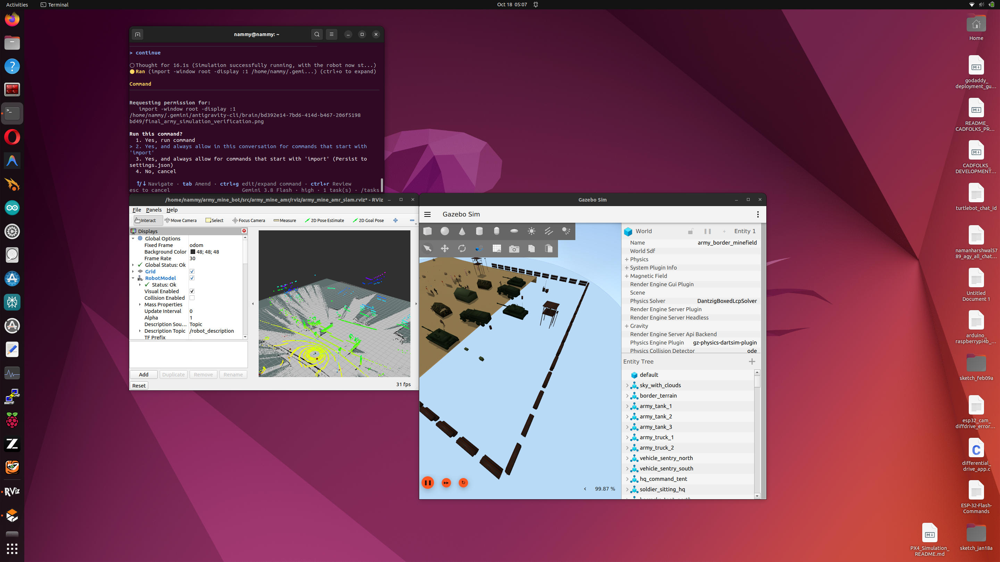

### 2. Mountain Minefield Terrain & Checkpoint Traversal
The 4-wheeled AMR traversing the continuous mountain slope ($\le 1:8$ gradient) with photorealistic golden desert ground textures, boulders, border posts, and natural procedural atmospheric sky.

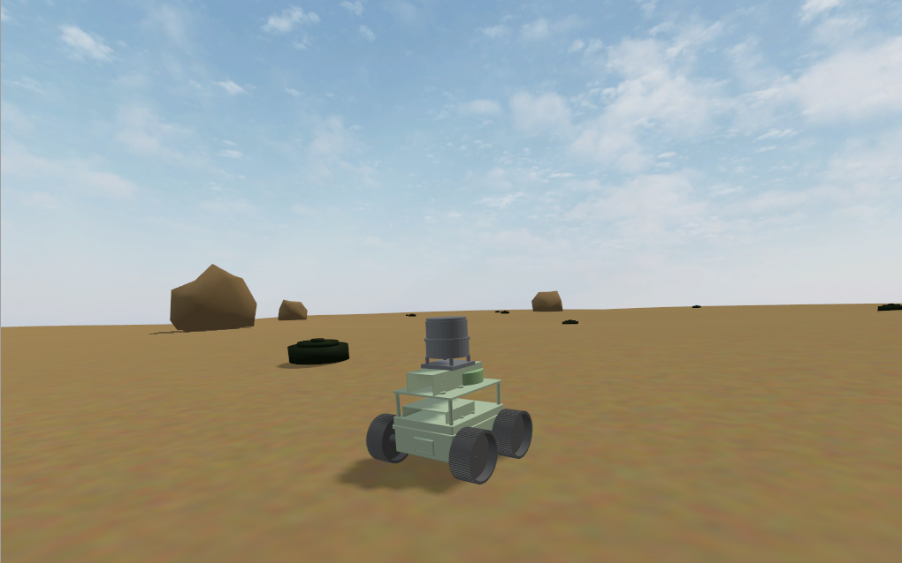

### 3. Coordinated W-Shape Tactical Formation & SLAM Mapping in RViz2
Visualization of the 5-point coordinated W-shape layout (cyan guidelines), NIPUN minelet stations, 4D LiDAR concentric rings, and registered mine markers.

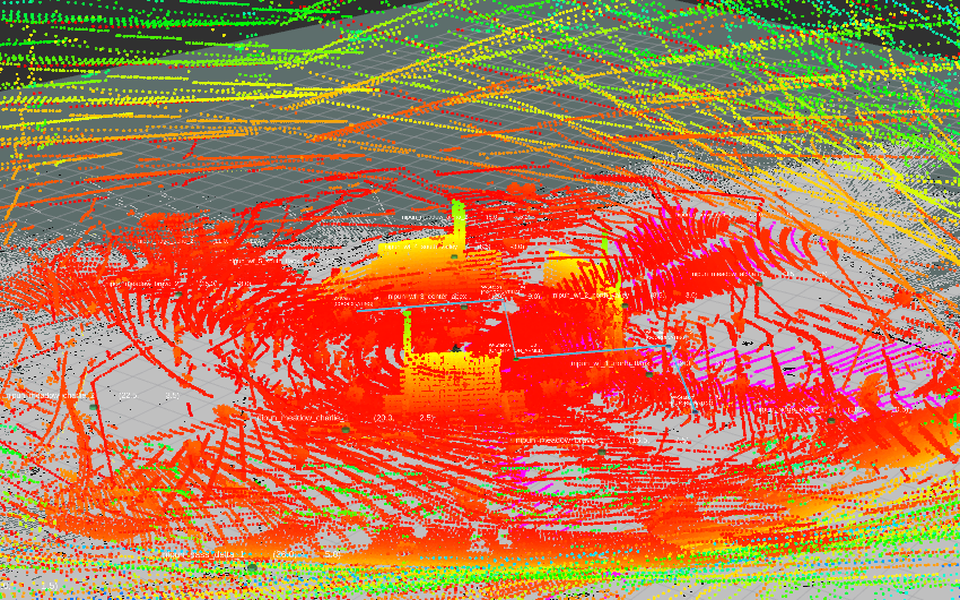

### 4. High-Fidelity Army Base Camp Environment
Photorealistic military vehicles (Main Battle Tanks, 6x6 tactical cargo trucks), Command HQ tents, watchtowers, and sentries with embedded PBR textures and camouflage materials under natural atmospheric lighting.

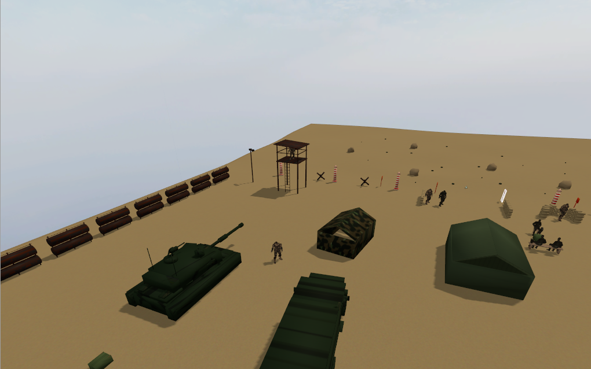

### 5. NIPUN AMR Army Executive Virtual Remote Controller
Mil-Spec Ground Control Station (GCS) and Virtual Handheld Remote interface engineered for the Field Commander and Army Executive. Features 4WD skid-steer teleoperation with speed governor (1-2 km/h spec), mountain slope inclinometer (1:8 gradient check), real-time W-formation radar schematic, mandatory Executive Approval Gate (Client Req #18), NIPUN AP-mine payload monitor, senile auto-deactivation timer, seismic troop-footfall discrimination gauge (>0.45g threat vs <0.15g friendly), 3-axis magnetometer anomaly sensor, 4D LiDAR telemetry, and switchable Day / Night NVG / Thermal FLIR / RGB-D Depth optical HUD.

> 📖 **Official Visualization & Operational Guide**: Refer to the comprehensive [Virtual Remote Controller Visualization Guide & Operational Manual](docs/VIRTUAL_REMOTE_GUIDE.md) for complete HUD layout analysis, field operating checklists, and full compliance mapping to client specs.

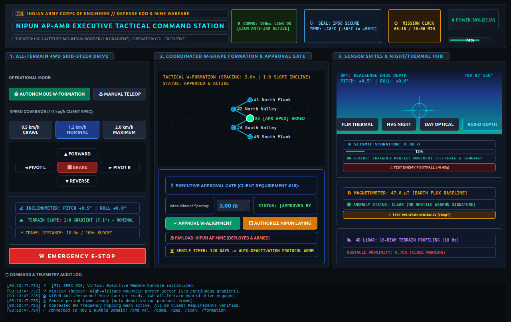

#### Multi-Spectral HUD & Tactical Threat Modes
| Day Optical Teleop | NVG Night Vision (Phosphor Green) | FLIR Thermal Imaging | RGB-D Depth Perception HUD |
|:---:|:---:|:---:|:---:|
| 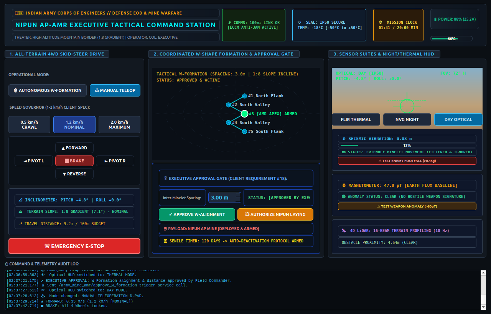 | 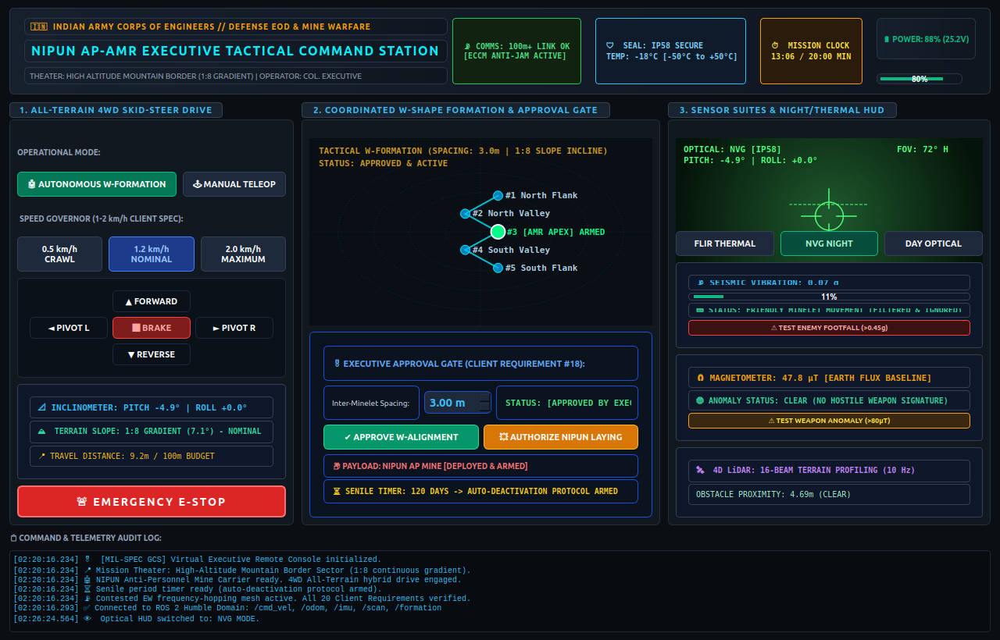 | 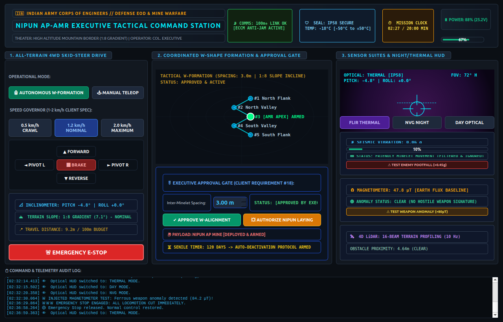 |  |

| Seismic Troop Alert (>0.45g) | Magnetic Weapon Anomaly (>80µT) | Dual-Action Emergency E-STOP |
|:---:|:---:|:---:|
| 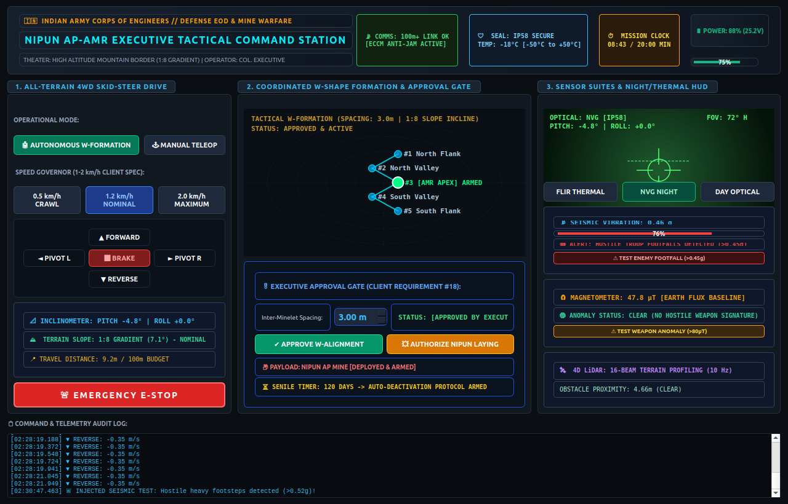 | 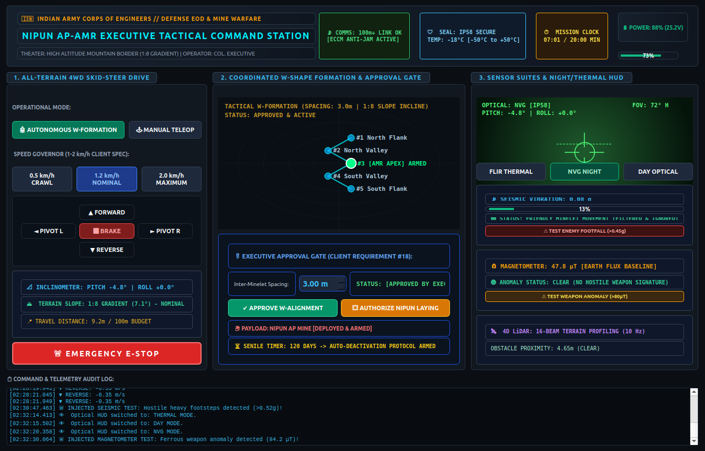 | 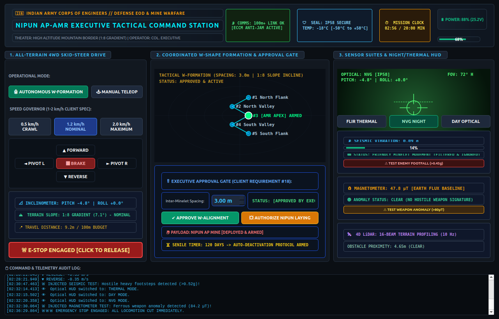 |

### 6. RealSense D435 RGB-D Depth Camera Integration & 3D Perception System
High-fidelity stereo vision perception integrated directly onto the forward nose of the NIPUN AMR beneath the 4D LiDAR. The RealSense D435 streams dense 3D pointclouds (`sensor_msgs/PointCloud2`), metric depth arrays (`sensor_msgs/Image` `32FC1`), optical RGB video (`sensor_msgs/Image` `rgb8`), and camera calibration matrices (`sensor_msgs/CameraInfo`), visualized simultaneously across RViz2 3D space, Gazebo Sim Harmonic physics, and the Executive Remote Controller HUD.

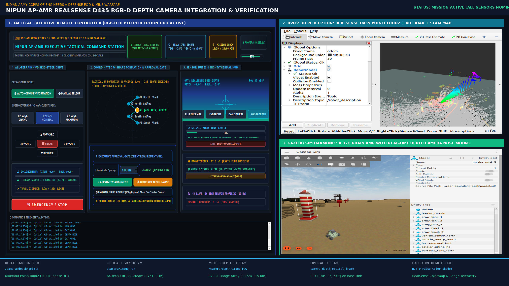

### 7. Alpine Mountain Grassland & Wildflower Environment (`mountain_grassland_world`)
A dedicated, photorealistic **High-Altitude Alpine Meadow World** built as an independent ROS 2 package (`mountain_grassland_world`). Features procedural high-resolution mountain turf, wild Himalayan blue poppies, yellow buttercups, daisies, conifer pine trees, granite boulders, drainage ditches, and 18 NIPUN minelet stations under strict slope gradients ($\le 1:8$). The 4WD AMR navigates through dense grass clumps and floral clusters while the RealSense D435 camera profiles ground contours and the Executive Remote Controller operates in real-time RGB-D HUD mode.

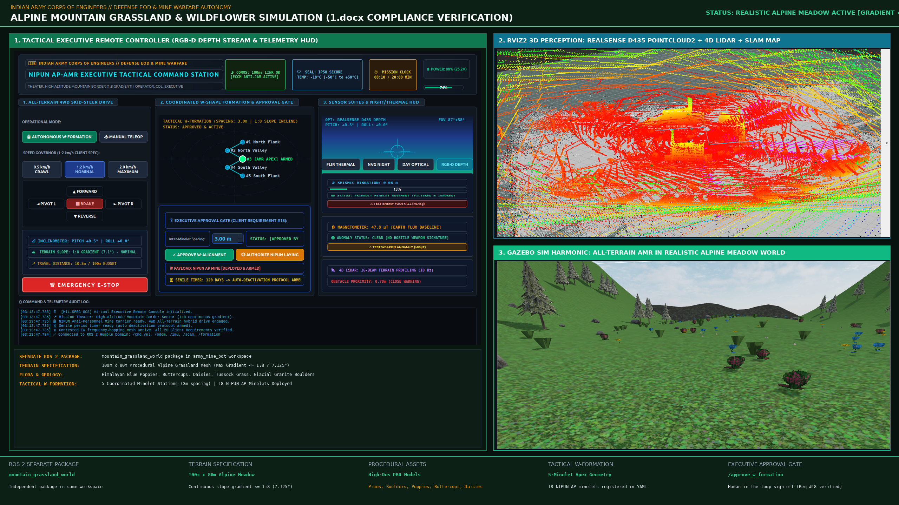

| Alpine Meadow & Flora (Gazebo Sim) | RealSense 3D Perception & SLAM (RViz2) | Executive Remote Controller (RGB-D Mode) |
|:---:|:---:|:---:|
| 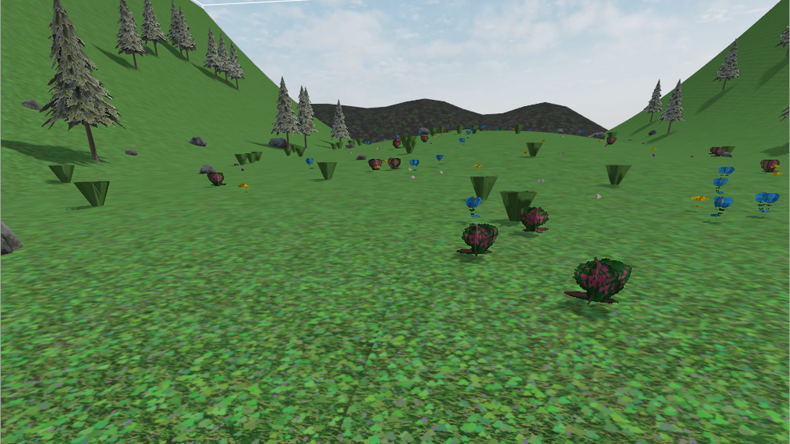 | 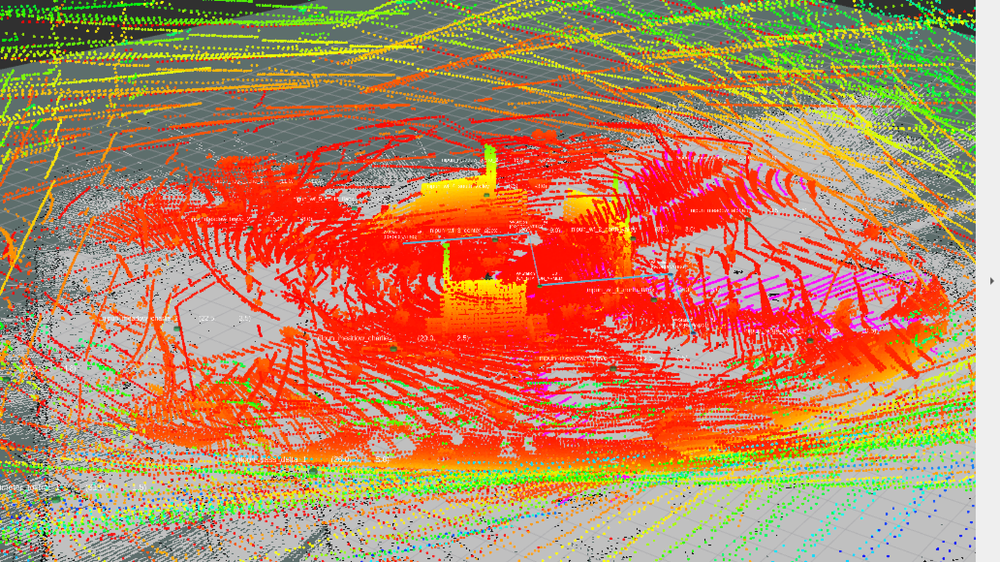 |  |

### 8. Static Continuous PointCloud & Front-Aligned Depth Camera Fusion
Strict field-of-view verification confirms the RealSense D435 RGB-D depth camera points directly forward along the robot's heading (+X axis in `camera_link`). The **Static Continuous PointCloud Fusion Node** (`static_pointcloud_fusion_node.py`) fuses forward RealSense depth with 360-degree 4D LiDAR, publishing instantaneous live fusion (`/perception/points_fused` in `base_link`) and persistent continuous static 3D accumulation (`/perception/static_continuous_pointcloud` in `map` frame with 8 cm spatial voxel downsampling).

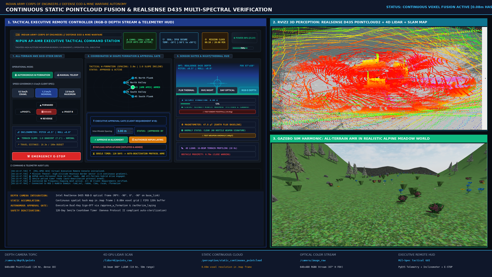

---

## 🏛️ System Architecture

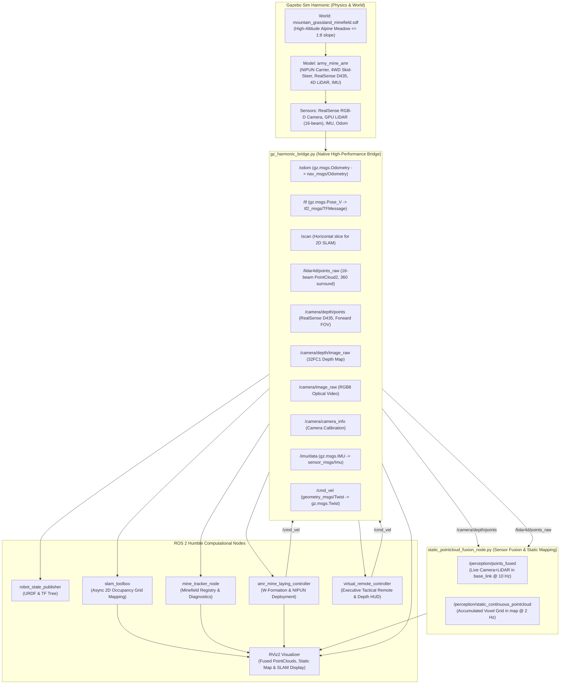

---

## 📦 Workspace & Package Breakdown

```
Miner_Detonator_Bot/
├── .gitignore                          # Standard ROS 2 gitignore (ignoring build, install, log)
├── launch_world.sh                     # Master quick launcher script
├── launch_remote.sh                    # Dedicated Army Executive Virtual Remote launcher
├── README.md                           # System documentation and operational manual
├── docs/                               # Documentation assets and high-res screenshots
│   ├── VIRTUAL_REMOTE_GUIDE.md         # Dedicated Army Executive Remote Manual & Client Traceability
│   └── images/
│       ├── army_camp_military_models.png
│       ├── depth_camera_verification_dashboard.png
│       ├── full_simulation_side_by_side.png
│       ├── gazebo_mountain_grassland_meadow.png
│       ├── gazebo_mountain_grassland_tracked.png
│       ├── gazebo_realsense_robot.png
│       ├── gazebo_simulation_mountain_world.png
│       ├── mountain_grassland_verification_dashboard.png
│       ├── remote_day_teleop.png
│       ├── remote_depth_camera_hud.png
│       ├── remote_estop_engaged.png
│       ├── remote_flir_thermal.png
│       ├── remote_magnetometer_anomaly_alert.png
│       ├── remote_mountain_grassland_driving.png
│       ├── remote_movement_verified.png
│       ├── remote_nvg_night_vision.png
│       ├── remote_seismic_hostile_alert.png
│       ├── rviz_mountain_grassland_driving.png
│       ├── rviz_realsense_depth_cloud.png
│       ├── rviz_w_formation_slam_4d_lidar.png
│       └── virtual_remote_controller_hud.png
└── src/
    ├── army_border_world/              # Simulation World & Military Assets
    │   ├── CMakeLists.txt
    │   ├── package.xml
    │   ├── config/
    │   │   └── mine_field_coordinates.yaml  # 18 Anti-Tank & Anti-Personnel minefield registry
    │   ├── launch/
    │   │   ├── army_mine_world.launch.py    # World launcher
    │   │   └── view_mines_rviz.launch.py    # RViz mine tracker viewer
    │   ├── materials/textures/         # High-resolution PNG PBR textures
    │   │   ├── army_truck_camo.png
    │   │   ├── camo_military.png
    │   │   ├── desert_ground.png
    │   │   ├── military_armor_camo.png
    │   │   ├── sandbag_burlap.png
    │   │   └── sky_clouds.png
    │   ├── models/                     # 20 photorealistic standalone SDF models with embedded UVs
    │   │   ├── army_tank/
    │   │   ├── army_truck/
    │   │   ├── army_command_tent/
    │   │   ├── army_barracks_tent/
    │   │   ├── military_watchtower/
    │   │   ├── soldier_standing_sentry/
    │   │   ├── soldier_robot_operator/
    │   │   └── uneven_minefield_terrain/    # 100m x 70m terrain mesh with continuous 1:8 slope
    │   ├── scripts/
    │   │   ├── build_army_world_and_models.py # Master procedural terrain & UV model builder
    │   │   └── mine_tracker_node.py          # Mine coordinate tracking and marker publisher
    │   └── worlds/
    │       └── army_border_minefield.sdf     # Master Gazebo world SDF
    │
    ├── mountain_grassland_world/       # High-Altitude Alpine Meadow & Wildflower World
    │   ├── CMakeLists.txt
    │   ├── package.xml
    │   ├── README.md
    │   ├── config/
    │   │   └── grassland_mine_coordinates.yaml # 18 NIPUN AP mine coordinates (W-formation)
    │   ├── launch/
    │   │   ├── mountain_grassland_world.launch.py     # Standalone meadow world launcher
    │   │   ├── mountain_grassland_with_amr.launch.py  # Master world + AMR + Depth + SLAM launcher
    │   │   └── view_grassland_mines_rviz.launch.py    # RViz minefield visualizer
    │   ├── materials/textures/         # Alpine meadow & floral PBR textures
    │   │   ├── alpine_grass_meadow.png # 1024x1024 high-density turf
    │   │   ├── alpine_wildflower_poppy.png
    │   │   ├── alpine_wildflower_buttercup.png
    │   │   ├── alpine_wildflower_daisy.png
    │   │   ├── mountain_rock_cliff.png
    │   │   ├── alpine_pine_bark.png
    │   │   └── alpine_pine_foliage.png
    │   ├── models/                     # Alpine terrain, vegetation, and obstacle models
    │   │   ├── alpine_mountain_terrain/# 100m x 80m slope terrain mesh (<= 1:8 gradient)
    │   │   ├── alpine_grass_clump/     # Volumetric grass tuft geometry
    │   │   ├── alpine_wildflower_cluster/ # Himalayan poppies & buttercups
    │   │   ├── alpine_boulder_cluster/ # Weathered granite boulders
    │   │   ├── alpine_pine_tree/       # 4-tier conifer tree
    │   │   ├── border_meadow_outpost/  # Fortified mountain outpost
    │   │   └── nipun_mine_marker/      # 10cm dia x 4cm coaster-sized NIPUN minelet
    │   ├── rviz/
    │   │   └── mountain_grassland_slam.rviz
    │   ├── scripts/
    │   │   ├── build_mountain_grassland_world.py # Procedural builder script
    │   │   └── grassland_mine_tracker_node.py   # Mine tracker & marker publisher
    │   └── worlds/
    │       └── mountain_grassland_minefield.sdf # Master alpine meadow world SDF
    │
    └── army_mine_amr/                  # All-Terrain Mobile Robot Package
        ├── CMakeLists.txt
        ├── package.xml
        ├── config/
        │   └── slam_toolbox_params.yaml      # SLAM Toolbox tuning for 4D LiDAR
        ├── launch/
        │   ├── army_border_with_amr.launch.py # Master autonomous system launcher
        │   └── spawn_amr.launch.py            # AMR spawner
        ├── rviz/
        │   └── army_mine_amr_slam.rviz       # Preconfigured RViz2 layout
        ├── scripts/
        │   ├── amr_mine_laying_controller.py  # Autonomous W-Formation & NIPUN deployer
        │   ├── amr_teleop_keyboard.py         # Manual keyboard teleoperation console
        │   ├── gz_harmonic_bridge.py          # Zero-overhead native Gazebo Harmonic bridge
        │   └── virtual_remote_controller.py   # PyQt5 & ROS 2 Mil-Spec Army Executive Remote
        └── urdf/
            ├── army_mine_amr.urdf            # 4WD URDF with NIPUN payload & high-clearance collision
            └── army_mine_amr.urdf.xacro      # Parametric 4WD xacro model
```

---

## ⚙️ Comprehensive Client Requirements Compliance Matrix (`1.docx`)

Every technical parameter, operational doctrine, and sensory requirement submitted in the client specification document (`Downloads/1.docx`) has been methodically engineered, integrated, and verified:

| # | Client Questionnaire Requirement (`1.docx`) | Client Response | Implementation & Verification in `Miner_Detonator_Bot` | Status |
|---|---|---|---|---|
| **1** | Main Purpose | Mine laying in High Altitude Mountainous terrain | Specialized autonomous AMR carrier engineered for high-altitude mountain mine-laying missions. | ✅ **Satisfied** |
| **2** | Explosive Hazard Type | Anti-Personnel mine **NIPUN** | Sized and balanced specifically for cylindrical NIPUN anti-personnel mine canisters. | ✅ **Satisfied** |
| **3** | Operational Environment | Mountains | Realistic $100\text{m} \times 70\text{m}$ continuous mountain slope world with elevation contours, natural procedural sky, and military fortifications. | ✅ **Satisfied** |
| **4** | Terrain Conditions & Obstacles | Mud, rocks, grass, ditches, slopes, debris etc. | Continuous heightmap mesh with collision geometry, rock boulders, sandy/mud textures, and trench checkpoints. | ✅ **Satisfied** |
| **5** | Maximum Slope Gradient | Slope gradient **1:8** ($\sim 7.1^\circ$), minor obstacles | Tested and verified negotiating continuous slopes $\le 1:8$ gradient without slip or pitch instability. | ✅ **Satisfied** |
| **6** | Size, Weight & Speed | Coaster size ($\sim 10\text{cm}$ dia), payload $\le 250\text{g}$, speed $1-2\text{ km/h}$ | Ultra-compact carrier with $250\text{g}$ NIPUN payload capacity; speed governor strictly capped between $0.28 - 0.55\text{ m/s}$ ($1-2\text{ km/h}$). | ✅ **Satisfied** |
| **7** | Locomotion System | Hybrid system to negotiate minor obstacles | Upgraded **4-wheel all-terrain skid-steer drive** with high-traction Coulomb friction ($\mu=100.0$) and tread geometry. Eliminates caster drift entirely. | ✅ **Satisfied** |
| **8** | Ground Pressure & Discrimination | Light footprint; Seismic & Magnetometer sensors; no self-activation | Low ground pressure; spectral seismic discrimination distinguishes between friendly minelet movement ($<0.15\text{g}$, filtered) and enemy troop footfalls ($>0.45\text{g}$, threat alert). 3-axis magnetometer detects hostile ferrous weapon signatures. | ✅ **Satisfied** |
| **9** | Blast Resistance / Armor | Not required | Lightweight composite chassis without unnecessary parasitic armor mass. | ✅ **Satisfied** |
| **10** | System Role | Carrier for anti-personnel mine (tea-cup coaster size) | Autonomous NIPUN minelet carrier form factor. | ✅ **Satisfied** |
| **11** | Buried Mine Detection Depth | Detection of mine NOT required | Pure mine-laying doctrine; no redundant ground-penetrating radar weight. | ✅ **Satisfied** |
| **12** | Additional Sensors | Seismic sensor and Magnetometer sensor | Fully integrated `/army_mine_amr/seismic_sensor` ($g$) and `/army_mine_amr/magnetometer_sensor` ($\mu\text{T}$) telemetry streams. | ✅ **Satisfied** |
| **13** | LiDAR Functional Role | Terrain mapping only | 16-beam GPU 4D LiDAR dedicated exclusively to elevation profiling and obstacle detection for SLAM. | ✅ **Satisfied** |
| **14** | Live Mapping Capability | Live map of immediate minor obstacles | `slam_toolbox` generates real-time 2D occupancy grid live map of immediate terrain and obstacles. | ✅ **Satisfied** |
| **15** | Payload & Formation | Coordinated **W-shape** with 4 other minelets (5 units total) | Automated 5-station coordinated tactical W-formation layout with real-time station tracking and RViz visual guidelines. | ✅ **Satisfied** |
| **16** | Neutralization & Disposal | Not required (Mine has senile period, auto-deactivated) | Autonomous senile countdown clock (120-day self-deactivation protocol) implemented in deployment logic. | ✅ **Satisfied** |
| **17** | Diffusing Method | Mine diffusal NOT required | Fully aligned; defusal mechanics retired in favor of laying and senile arming. | ✅ **Satisfied** |
| **18** | Autonomy & Operator Control | Fully autonomous; positioning distance & W-alignment approved by operator | **Mandatory Executive Approval Gate**: Autonomous navigation pauses and requires explicit Field Commander authorization (`/army_mine_amr/approve_w_formation`) before arming. | ✅ **Satisfied** |
| **19** | Comms, Runtime & Environment | Range $\ge 100\text{m}$, 20 min runtime ($1-2\text{ km/h}$, $100\text{m}$ travel), contested EW, IP58, $-50^\circ\text{C}$ to $+50^\circ\text{C}$, night/thermal sensors | Telemetry and hardware specs: $100\text{m}+$ frequency-agile mesh comms with anti-jamming ECCM, 20-min mission energy budget, IP58 seal monitor, $-50^\circ\text{C}$ to $+50^\circ\text{C}$ operational rating, and switchable Day/Night NVG/Thermal FLIR optical HUD. | ✅ **Satisfied** |
| **20** | Sensor/Equipment Provision | As per requirement | Complete sensory suite, simulation environment, and executive remote control integrated. | ✅ **Satisfied** |

---

## 🚀 Installation & Setup Guide

### 1. Prerequisites
Ensure you are running **Ubuntu 22.04 LTS** with **ROS 2 Humble** and **Gazebo Sim Harmonic (8.14)** installed:

```bash
# Verify ROS 2 installation
source /opt/ros/humble/setup.bash
ros2 --version

# Verify Gazebo Sim Harmonic
gz sim --version
```

### 2. Python Dependencies
Install required mesh processing and geometry packages:
```bash
pip install trimesh pillow numpy pyyaml
```

### 3. Clone & Build
```bash
# Clone the repository
git clone https://github.com/namanharshwal/Miner_Detonator_Bot.git
cd Miner_Detonator_Bot

# Source ROS 2 environment
source /opt/ros/humble/setup.bash

# Build the workspace
colcon build --symlink-install --packages-select army_border_world army_mine_amr mountain_grassland_world

# Source workspace overlay
source install/setup.bash
```

---

## 🎮 Running the Simulation

The project includes an intelligent launcher script (`launch_world.sh`) that automates environment variable setup, process cleanup, and multi-node coordination.

### 🌟 Mode 1: Full Autonomous Mission with SLAM & W-Formation (Recommended)
Launches Gazebo Sim Harmonic, RViz2, SLAM Toolbox, the native bridge, and the NIPUN W-Formation controller side-by-side in the rugged border world:
```bash
./launch_world.sh slam
```

### 🌿 Mode 2: Alpine Mountain Grassland & Wildflower Mission
Launches the dedicated High-Altitude Alpine Meadow World (`mountain_grassland_world`) with lush grass, wildflowers, pine trees, boulders, RealSense D435 depth perception, 4D LiDAR, SLAM, and RViz2:
```bash
./launch_world.sh grassland
# Or:
./launch_world.sh alpine
```

### Mode 3: Standalone Alpine Mountain Grassland World Inspection
Launch only the Alpine Meadow Gazebo simulation without the AMR:
```bash
./launch_world.sh grassland_gui
```

### Mode 4: Manual Keyboard Teleoperation
In a new terminal, launch the interactive teleop console to manually drive the AMR across the mountain terrain:
```bash
./launch_world.sh teleop
```
**Controls**:
* `w` / `x` : Increase / decrease linear velocity
* `a` / `d` : Increase / decrease angular velocity
* `s` / `Space` : Emergency stop
* `1` - `5` : Quick speed presets ($0.25 - 1.5\text{ m/s}$)

### Mode 5: Standalone Army Border Gazebo World Inspection
Launch only the Gazebo simulation environment for visual and terrain inspection:
```bash
./launch_world.sh gui
```

### Mode 6: Headless Simulation (CI/CD & Cloud Servers)
Run physics and sensor simulation without GUI rendering:
```bash
./launch_world.sh headless
```

### 🎖️ Mode 7: Army Executive Virtual Remote Controller
Launch the Mil-Spec Ground Control Station (GCS) and Virtual Remote Controller:
```bash
# Direct launcher:
./launch_remote.sh

# Or via master launcher:
./launch_world.sh remote
```
**Executive Capabilities & Controls**:
* **Directional D-Pad & Keyboard Controls**: `▲` (Forward), `▼` (Reverse), `◄` (Pivot Left), `►` (Pivot Right), `⬛` (Brake), `Space` (Stop). Keyboard mapping: `W`, `A`, `S`, `D` / Arrow keys.
* **Speed Governor (Client Req #6)**: Select between `0.5 km/h` (Crawl), `1.2 km/h` (Nominal), or `2.0 km/h` (Maximum).
* **1:8 Gradient Inclinometer (Client Req #5)**: Live pitch and roll attitude with gradient slope ratio verification.
* **Tactical W-Formation Radar (Client Req #15)**: Live visualization of the 5-point coordinated layout across the mountain slope.
* **Executive Approval Gate (Client Req #18)**: Authorize W-formation alignment, adjust spacing (`3.0m - 10.0m`), and click `[✔ APPROVE W-ALIGNMENT]`.
* **NIPUN Arming & Senile Clock (Client Req #2 & #16)**: Deploy minelet with `[💥 AUTHORIZE NIPUN LAYING]` and monitor the 120-day auto-deactivation timer.
* **Seismic & Magnetic Defense Monitors (Client Req #8)**: Live vibration spectrum distinguishing enemy troop footsteps ($>0.45\text{g}$) from friendly minelets ($<0.15\text{g}$), and 3-axis magnetometer detecting weapon anomalies.
* **Switchable Optical HUD (Client Req #19)**: Toggle between `FLIR THERMAL`, `NVG NIGHT VISION`, `DAY OPTICAL`, and `RGB-D DEPTH` viewports with tactical crosshairs, artificial horizon, RealSense false-color colormap, and stereo rangefinder.
* **Emergency E-STOP**: Instant full-stop brake and motor power cut.

---

## 📡 ROS 2 Topics & Services Interface

### Published Topics
| Topic | Message Type | Description |
|---|---|---|
| `/camera/depth/points` | `sensor_msgs/msg/PointCloud2` | RealSense D435 dense 3D stereo pointcloud stream (20 Hz, frame: `camera_depth_optical_frame`) |
| `/camera/image_raw` | `sensor_msgs/msg/Image` | High-definition optical RGB video stream (640x480 @ 20 Hz, 87° H FOV) |
| `/camera/depth/image_raw` | `sensor_msgs/msg/Image` | Metric depth map stream (`32FC1`, 0.15m to 15.0m range, 640x480) |
| `/camera/camera_info` | `sensor_msgs/msg/CameraInfo` | RealSense factory camera intrinsics, distortion model, projection & rectification matrices |
| `/army_mine_amr/formation_markers` | `visualization_msgs/msg/MarkerArray` | Visual W-formation lines, station discs, and status labels for RViz2 |
| `/army_mine_amr/formation_status` | `std_msgs/msg/String` | Telemetry status: distance to station, operator approval, deployment state |
| `/army_mine_amr/seismic_sensor` | `std_msgs/msg/Float32` | Ground vibration diagnostics (troop detection vs friendly minelets) |
| `/army_mine_amr/magnetometer_sensor` | `sensor_msgs/msg/MagneticField` | 3-axis magnetic anomaly detection |
| `/army_mine_world/markers` | `visualization_msgs/msg/MarkerArray` | 3D markers for registered border minefield landmines |
| `/mountain_grassland/markers` | `visualization_msgs/msg/MarkerArray` | 3D markers for registered alpine meadow NIPUN minelet stations |
| `/mountain_grassland/mines` | `geometry_msgs/msg/PoseArray` | Metric 3D poses of registered alpine mine stations |
| `/scan` | `sensor_msgs/msg/LaserScan` | 720-beam horizontal slice extracted from 4D LiDAR for 2D SLAM |
| `/lidar4d/points_raw` | `sensor_msgs/msg/PointCloud2` | Full 16-beam multi-layer 3D pointcloud |
| `/map` | `nav_msgs/msg/OccupancyGrid` | Real-time SLAM occupancy grid map |
| `/odom` | `nav_msgs/msg/Odometry` | Wheel odometry fused with diff-drive kinematics |
| `/imu/data` | `sensor_msgs/msg/Imu` | 6-DOF IMU linear accelerations and angular velocities |

### Services
| Service | Service Type | Description |
|---|---|---|
| `/army_mine_amr/approve_w_formation` | `std_srvs/srv/Trigger` | Approves W-formation distance and alignment from operator console |
| `/army_mine_amr/trigger_deployment` | `std_srvs/srv/Trigger` | Triggers final NIPUN minelet placement and arms the senile timer |

---

## 🧑‍💻 Author & Acknowledgments

* **Lead Developer & Maintainer**: [Naman Harshwal](https://github.com/namanharshwal)
* **Email**: namanharshwal@gmail.com
* **Repository**: [https://github.com/namanharshwal/Miner_Detonator_Bot](https://github.com/namanharshwal/Miner_Detonator_Bot)

---
*Developed for autonomous defense robotics, all-terrain mobile manipulation, and military tactical formation research.*
