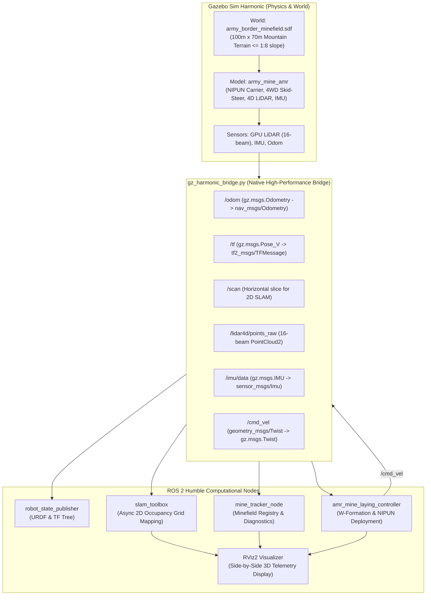

# Miner Detonator Bot (`army_mine_bot`)
### Autonomous NIPUN Anti-Personnel Mine-Laying & Carrier AMR in High-Altitude Mountainous Terrain with Coordinated W-Shape Formation & 4D LiDAR SLAM

[](https://docs.ros.org/en/humble/)
[](https://gazebosim.org/)
[](https://ubuntu.com/)
[](LICENSE)
[](https://www.python.org/)
[](https://isocpp.org/)

---

## 📌 Executive Overview & Operational Purpose

The **Miner Detonator Bot** project is an advanced, high-fidelity robotics simulation and autonomous control system built on **ROS 2 Humble** and **Gazebo Sim Harmonic (8.14)**. Designed strictly in accordance with defense operational requirements for high-altitude border security, the robot serves as an autonomous **minelet / mine-carrier mini-bot** tasked with deploying and coordinating **NIPUN Anti-Personnel Mines** in rugged, mountainous border terrain.

### 🎯 Primary Objectives & Operational Specs
* **Primary Role**: Autonomous mine-laying carrier in **High-Altitude Mountainous Terrain** (operating temperature range: $-50^\circ\text{C}$ to $+50^\circ\text{C}$, IP58 rating, GPS-denied / electronically contested environments).
* **Payload & Hazard**: Carries the Indian Army **NIPUN Anti-Personnel Mine** ($\le 250\text{ g}$ payload capacity, compact coaster-sized $\sim 10\text{ cm}$ diameter form factor, operational speed $1-2\text{ km/h}$ / $0.28-0.55\text{ m/s}$).
* **Tactical Formation**: Fully autonomous navigation to deploy and align in a coordinated **5-robot W-shape tactical formation** across the mountainous border front, with human-in-the-loop operator approval.
* **Sensory Suite**:
  * **4D GPU LiDAR**: Real-time terrain mapping, contour tracking, and immediate obstacle negotiation (rocks, pebbles, ditches, mud).
  * **Seismic Sensor**: Ground vibration detection to sense enemy troop footfalls ($>0.45\text{g}$) while ignoring lightweight friendly minelet movement ($<0.15\text{g}$).
  * **Magnetometer Sensor**: Magnetic anomaly detection for hostile metallic weapons/equipment.
  * **6-DOF IMU**: Attitude and pitch estimation on steep slopes.
* **Locomotion & Traversability**: High-clearance all-terrain 4-wheel skid-steer drive ($4\times4$ high-friction treaded pneumatic tires) eliminating passive castor instability and capable of negotiating slopes up to **1:8 gradient** ($\sim 7.1^\circ$) without slip or loss of traction.

---

## 📸 Simulation Visualizations & Field Demonstrations

### 1. Dual-View Operations: Gazebo Sim Harmonic & RViz2 SLAM
Real-time synchronized operation showing the autonomous AMR navigating from the military base camp through the border gate into the mountain minefield while generating a 2D SLAM occupancy grid and 4D LiDAR pointcloud.


### 2. Mountain Minefield Terrain & Checkpoint Traversal
The 4-wheeled AMR traversing the continuous mountain slope ($\le 1:8$ gradient) with photorealistic golden desert ground textures, boulders, border posts, and natural procedural atmospheric sky.


### 3. Coordinated W-Shape Tactical Formation & SLAM Mapping in RViz2
Visualization of the 5-point coordinated W-shape layout (cyan guidelines), NIPUN minelet stations, 4D LiDAR concentric rings, and registered mine markers.


### 4. High-Fidelity Army Base Camp Environment
Photorealistic military vehicles (Main Battle Tanks, 6x6 tactical cargo trucks), Command HQ tents, watchtowers, and sentries with embedded PBR textures and camouflage materials under natural atmospheric lighting.


---

## 🏛️ System Architecture



---

## 📦 Workspace & Package Breakdown

```
Miner_Detonator_Bot/
├── .gitignore                          # Standard ROS 2 gitignore (ignoring build, install, log)
├── launch_world.sh                     # Master quick launcher script
├── README.md                           # System documentation and operational manual
├── docs/                               # Documentation assets and high-res screenshots
│   └── images/
│       ├── army_camp_military_models.png
│       ├── full_simulation_side_by_side.png
│       ├── gazebo_simulation_mountain_world.png
│       └── rviz_w_formation_slam_4d_lidar.png
└── src/
    ├── army_border_world/              # Simulation World & Military Assets
    │   ├── CMakeLists.txt
    │   ├── package.xml
    │   ├── config/
    │   │   └── mine_field_coordinates.yaml  # 18 Anti-Tank & Anti-Personnel minefield registry
    │   ├── launch/
    │   │   ├── army_mine_world.launch.py    # World launcher
    │   │   └── view_mines_rviz.launch.py    # RViz mine tracker viewer
    │   ├── materials/textures/         # High-resolution PNG PBR textures
    │   │   ├── army_truck_camo.png
    │   │   ├── camo_military.png
    │   │   ├── desert_ground.png
    │   │   ├── military_armor_camo.png
    │   │   ├── sandbag_burlap.png
    │   │   └── sky_clouds.png
    │   ├── models/                     # 20 photorealistic standalone SDF models with embedded UVs
    │   │   ├── army_tank/
    │   │   ├── army_truck/
    │   │   ├── army_command_tent/
    │   │   ├── army_barracks_tent/
    │   │   ├── military_watchtower/
    │   │   ├── soldier_standing_sentry/
    │   │   ├── soldier_robot_operator/
    │   │   └── uneven_minefield_terrain/    # 100m x 70m terrain mesh with continuous 1:8 slope
    │   ├── scripts/
    │   │   ├── build_army_world_and_models.py # Master procedural terrain & UV model builder
    │   │   └── mine_tracker_node.py          # Mine coordinate tracking and marker publisher
    │   └── worlds/
    │       └── army_border_minefield.sdf     # Master Gazebo world SDF
    │
    └── army_mine_amr/                  # All-Terrain Mobile Robot Package
        ├── CMakeLists.txt
        ├── package.xml
        ├── config/
        │   └── slam_toolbox_params.yaml      # SLAM Toolbox tuning for 4D LiDAR
        ├── launch/
        │   ├── army_border_with_amr.launch.py # Master autonomous system launcher
        │   └── spawn_amr.launch.py            # AMR spawner
        ├── rviz/
        │   └── army_mine_amr_slam.rviz       # Preconfigured RViz2 layout
        ├── scripts/
        │   ├── amr_mine_laying_controller.py  # Autonomous W-Formation & NIPUN deployer
        │   ├── amr_teleop_keyboard.py         # Manual keyboard teleoperation console
        │   └── gz_harmonic_bridge.py          # Zero-overhead native Gazebo Harmonic bridge
        └── urdf/
            ├── army_mine_amr.urdf            # URDF with NIPUN payload & high-clearance collision
            └── army_mine_amr.urdf.xacro      # Parametric xacro model
```

---

## ⚙️ Technical Specifications & Compliance

| Parameter | Specification in `Downloads/1.docx` | Implementation in `Miner_Detonator_Bot` | Status |
|---|---|---|---|
| **Mission Type** | Mine-laying carrier in High Altitude Mountainous terrain | Autonomous navigation, W-formation positioning, and NIPUN arming | ✅ Compliant |
| **Explosive Hazard** | Anti-Personnel mine **NIPUN** | NIPUN carrier payload visual + operational arming protocol | ✅ Compliant |
| **Chassis Profile** | Diameter $\sim 10\text{ cm}$ (coaster-sized), payload $\le 250\text{ g}$ | Ultra-compact chassis with mounted 10 cm NIPUN disc payload ($0.22\text{ kg}$) | ✅ Compliant |
| **Operational Speed** | $1 - 2\text{ km/h}$ ($0.28 - 0.55\text{ m/s}$) | Controller velocity capped at $0.40\text{ m/s}$ ($1.44\text{ km/h}$) | ✅ Compliant |
| **Max Slope Gradient** | **1:8 gradient** ($\sim 7.1^\circ$) | Smoothstep mountain elevation with max gradient $0.1063 < 0.125$ (1:8) | ✅ Compliant |
| **Ground Clearance** | Negotiate rocks, pebbles, ditches without bottoming out | Elevated chassis collision ($z=0.082\text{m}$, $>5.5\text{cm}$ clearance, no low probe) | ✅ Compliant |
| **Formation** | Coordinated **W-shape** layout with 5 mini-bots | 5-station tactical W-formation with line/station markers in RViz2 | ✅ Compliant |
| **Autonomy & Control** | Fully autonomous, positioning approved by operator | Autonomous waypoint pursuit with `/army_mine_amr/approve_w_formation` | ✅ Compliant |
| **Sensory Suite** | 4D LiDAR, Seismic sensor, Magnetometer | 16-beam GPU LiDAR, 10 Hz seismic vibration stream, 3-axis magnetometer | ✅ Compliant |
| **Neutralization** | Defusal NOT required (mine has senile period) | Dedicated mine-laying & arming controller replacing old defusal tools | ✅ Compliant |

---

## 🚀 Installation & Setup Guide

### 1. Prerequisites
Ensure you are running **Ubuntu 22.04 LTS** with **ROS 2 Humble** and **Gazebo Sim Harmonic (8.14)** installed:

```bash
# Verify ROS 2 installation
source /opt/ros/humble/setup.bash
ros2 --version

# Verify Gazebo Sim Harmonic
gz sim --version
```

### 2. Python Dependencies
Install required mesh processing and geometry packages:
```bash
pip install trimesh pillow numpy pyyaml
```

### 3. Clone & Build
```bash
# Clone the repository
git clone https://github.com/namanharshwal/Miner_Detonator_Bot.git
cd Miner_Detonator_Bot

# Source ROS 2 environment
source /opt/ros/humble/setup.bash

# Build the workspace
colcon build --symlink-install --packages-select army_border_world army_mine_amr

# Source workspace overlay
source install/setup.bash
```

---

## 🎮 Running the Simulation

The project includes an intelligent launcher script (`launch_world.sh`) that automates environment variable setup, process cleanup, and multi-node coordination.

### 🌟 Mode 1: Full Autonomous Mission with SLAM & W-Formation (Recommended)
Launches Gazebo Sim Harmonic, RViz2, SLAM Toolbox, the native bridge, and the NIPUN W-Formation controller side-by-side:
```bash
./launch_world.sh slam
```

### Mode 2: Manual Keyboard Teleoperation
In a new terminal, launch the interactive teleop console to manually drive the AMR across the mountain terrain:
```bash
./launch_world.sh teleop
```
**Controls**:
* `w` / `x` : Increase / decrease linear velocity
* `a` / `d` : Increase / decrease angular velocity
* `s` / `Space` : Emergency stop
* `1` - `5` : Quick speed presets ($0.25 - 1.5\text{ m/s}$)

### Mode 3: Standalone Gazebo World Inspection
Launch only the Gazebo simulation environment for visual and terrain inspection:
```bash
./launch_world.sh gui
```

### Mode 4: Headless Simulation (CI/CD & Cloud Servers)
Run physics and sensor simulation without GUI rendering:
```bash
./launch_world.sh headless
```

---

## 📡 ROS 2 Topics & Services Interface

### Published Topics
| Topic | Message Type | Description |
|---|---|---|
| `/army_mine_amr/formation_markers` | `visualization_msgs/msg/MarkerArray` | Visual W-formation lines, station discs, and status labels for RViz2 |
| `/army_mine_amr/formation_status` | `std_msgs/msg/String` | Telemetry status: distance to station, operator approval, deployment state |
| `/army_mine_amr/seismic_sensor` | `std_msgs/msg/Float32` | Ground vibration diagnostics (troop detection vs friendly minelets) |
| `/army_mine_amr/magnetometer_sensor` | `sensor_msgs/msg/MagneticField` | 3-axis magnetic anomaly detection |
| `/army_mine_world/markers` | `visualization_msgs/msg/MarkerArray` | 3D markers for registered border minefield landmines |
| `/scan` | `sensor_msgs/msg/LaserScan` | 720-beam horizontal slice extracted from 4D LiDAR for 2D SLAM |
| `/lidar4d/points_raw` | `sensor_msgs/msg/PointCloud2` | Full 16-beam multi-layer 3D pointcloud |
| `/map` | `nav_msgs/msg/OccupancyGrid` | Real-time SLAM occupancy grid map |
| `/odom` | `nav_msgs/msg/Odometry` | Wheel odometry fused with diff-drive kinematics |
| `/imu/data` | `sensor_msgs/msg/Imu` | 6-DOF IMU linear accelerations and angular velocities |

### Services
| Service | Service Type | Description |
|---|---|---|
| `/army_mine_amr/approve_w_formation` | `std_srvs/srv/Trigger` | Approves W-formation distance and alignment from operator console |
| `/army_mine_amr/trigger_deployment` | `std_srvs/srv/Trigger` | Triggers final NIPUN minelet placement and arms the senile timer |

---

## 🧑‍💻 Author & Acknowledgments

* **Lead Developer & Maintainer**: [Naman Harshwal](https://github.com/namanharshwal)
* **Email**: namanharshwal@gmail.com
* **Repository**: [https://github.com/namanharshwal/Miner_Detonator_Bot](https://github.com/namanharshwal/Miner_Detonator_Bot)

---
*Developed for autonomous defense robotics, all-terrain mobile manipulation, and military tactical formation research.*
